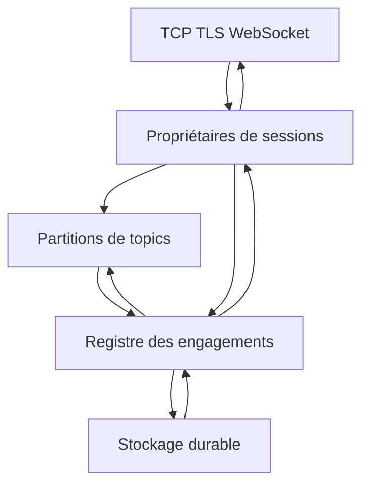

**Version proposée 0.1 — 14 novembre 2026**

Ce chapitre précise l’architecture de référence de `mqttiumd` à partir du [chapitre 1 sur la compatibilité et les garanties de reprise](https://chatgpt.com/space/page_a2d3db83cc088191b97e714ae72dd04a). Il définit les propriétaires d’état, les identités, les événements et effets, les transactions, le routage, les abonnements et les conditions de progression.

**Décision proposée : un cœur synchrone déterministe, des propriétaires de sessions, des partitions de topics et un registre transactionnel commun pour les engagements durables.** Tokio exécute les entrées et sorties et ordonnance les propriétaires ; SQLite WAL avec synchronisation FULL sert de stockage de référence.

Cette architecture doit permettre de construire et de mesurer les prototypes. Sa correction complète et son adéquation aux objectifs de performance restent des critères de passage. Les interfaces et schémas présentés sont des contrats de conception, pas du code compilé ou des résultats de test.

# 1 Décision de référence

**ARC-001 — Architecture R1.** La référence comporte quatre domaines : machines de sessions, routage par partitions de topics, registre d’engagements et adaptateurs d’entrées et sorties. Chaque état mutable possède un propriétaire logique explicite.

| Domaine | Responsabilités |
| - | - |
| SessionCore | Cycle de vie de session, machines QoS, numéros de paquets, contraintes d’émission |
| TopicCore | Matching, ordre local, préparation des admissions, activation des abonnements et retained |
| StoreCore | Validation des commandes, quotas durables, résultats et ordre d’engagement |
| Adaptateurs | Sockets, TLS, décodage incrémental, écritures partielles, stockage physique, authentification et temps |



Les flèches représentent des commandes, des résultats ou des effets, pas des appels bloquants entre propriétaires. Le matching et le traitement des connexions peuvent s’exécuter sur plusieurs cœurs. Une décision locale de topic et les commits du magasin restent ordonnés.

Le registre commun évite d’introduire immédiatement un protocole de transaction entre plusieurs bases. Il ne sera conservé comme stockage de production que si les mesures démontrent qu’il répond aux objectifs.

# 2 Comparaison des organisations du routage

| Critère | Index partagé immutable | Partitions propriétaires de topics |
| - | - | - |
| Matching concurrent | Parallèle, y compris pour un topic chaud | Parallèle entre propriétaires |
| Abonnements | Versions partagées et collecte | Projections locales, wildcards répliqués |
| Retained et nouvelles publications | Couplage explicite entre versions et commits | Ordre local commun |
| Churn | Coordinateur de versions | Activation sur les partitions concernées |
| Risque principal | Snapshot mémoire incompatible avec l’état engagé | Topic chaud et coût des wildcards |
| Position proposée | Optimisation à réévaluer | Référence R1 |

**ARC-002 — Ordre explicite.** Un index immutable peut servir de vue de lecture, mais il ne suffit pas à définir l’admission.

Contre-exemple : une publication P lit l’ancien index, puis attend son commit ; un abonnement S devient visible et capture l’ancien retained ; P engage ensuite une nouvelle valeur retained. S peut manquer cette valeur à la fois dans le replay et dans le flux live. Une structure sans verrou ne résout pas cette course.

R1 place la publication et l’activation dans l’ordre d’un même propriétaire. Une autre architecture devra démontrer une coupure équivalente au moyen de barrières, de versions ou de validations transactionnelles.

# 3 Partitions logiques et exécution physique

**ARC-003 — Identités stables.** Les nombres de partitions de sessions et de routage sont enregistrés dans les métadonnées du magasin. Leur affectation aux workers peut changer au redémarrage. Le numéro d’un worker physique n’entre dans aucune identité persistante.

La partition d’un topic dépend d’une fonction stable appliquée à son nom complet, après résolution d’un éventuel alias de connexion. L’algorithme, ses paramètres et sa version sont persistants. Un filtre exact cible une partition ; un wildcard peut nécessiter toutes les partitions.

Une session est affectée à un propriétaire de session selon une règle stable. Un propriétaire logique peut gérer plusieurs sessions. Il n’est pas nécessaire de créer un thread par session ni d’empêcher une tâche Tokio de changer de thread : l’exigence porte sur l’absence de mutations simultanées.

Changer le nombre de workers doit être un redémarrage ordinaire. Changer le partitionnement des données est une migration explicite.

Le build x86-64 de base ne doit pas exiger AVX2. Les accélérations dépendantes du processeur restent sélectionnées par un mécanisme qualifié. Les profils ARM64 et x86-64 conservent les mêmes invariants.

Les caches de topics sont bornés. Un producteur inventant continuellement de nouveaux noms ne doit pas créer un objet permanent pour chaque topic déjà observé.

# 4 Frontière entre cœur et runtime

**ARC-004 — Transition bornée.** Le cœur expose une transition synchrone de la forme suivante :

```rust
fn step(
    state: &mut OwnerState,
    input: Input,
    grant: TurnGrant,
    effects: &mut BoundedEffectBatch,
) -> StepOutcome;
```

Ce schéma décrit une interface. Les types concrets seront figés dans le prototype P1.

Le cœur ne contient ni await, ni socket, ni accès fichier, ni lecture d’horloge, ni génération aléatoire cachée, ni callback utilisateur. Le temps, les résultats IO et les décisions externes arrivent comme données d’entrée. Le cœur de production est celui exécuté en simulation.

TurnGrant borne le travail d’un tour et les ressources de sortie disponibles. Le cœur vérifie cette capacité avant les mutations qui en dépendent. NeedCapacity conserve l’entrée et ne laisse pas une transition partiellement appliquée.

Un calcul de matching, un fanout, un nettoyage ou un replay volumineux devient une continuation identifiée et bornée. Ces continuations, leurs buffers et leurs effets en attente sont eux-mêmes comptés.

Le cœur distingue état engagé, préparation et résultat indéterminé. Une préparation peut modifier son état de suivi interne ; elle ne rend pas les effets dépendants du commit visibles au réseau.

Les effets sont des données typées. Ils ne contiennent ni future, ni closure arbitraire, ni pointeur vers un état mutable extérieur. Le cœur propre au projet doit interdire unsafe ; cela n’élimine pas la base de confiance des dépendances et de l’environnement.

# 5 Identités et références

**ARC-005 — Absence de réutilisation ambiguë.** Les identités doivent distinguer le magasin, l’exécution, l’entité et sa révision.

| Identité | Objet et règle |
| - | - |
| StoreIncarnation | Identité du jeu de données ; restauration et duplication suivent une procédure explicite |
| RunEpoch | Époque de démarrage enregistrée avant admission |
| LogicalOwnerId | Propriétaire logique indépendant des threads |
| SessionId | Stable lors d’une reprise, nouvelle lors d’une recréation |
| ConnectionGeneration | Nouvelle pour chaque connexion |
| RequestId | Demande logique conservée pendant les nouvelles préparations admissibles |
| OperationId | Commande immutable précise, stable pendant sa réconciliation et son rejeu |
| RouteVersion | Révision engagée servant aux coupures retained, distincte d’un ordre de réception |
| EffectId | Effet précis d’une opération et résultat correspondant |
| PublicationId | Publication interne, indépendante du Packet Identifier |
| DeliveryId | Obligation vers une destination précise |
| ExchangeId | Échange QoS, y compris une génération interne du slot réutilisé |
| SubscriptionRevision | Définition d’abonnement et opération de remplacement |
| TimerToken | Entité, nature d’échéance et génération |
| PacketLease | Réservation d’un numéro MQTT jusqu’à libération protocolaire sûre |

Une construction possible pour OperationId associe incarnation, époque, propriétaire et séquence monotone. Une même OperationId ne peut jamais désigner deux commandes différentes. Une reproposition après résultat indéterminé conserve exactement la commande ; une nouvelle préparation après refus certain reçoit une nouvelle OperationId, tout en gardant la RequestId et l’ordre logique de publication. Les débordements de compteurs ne doivent pas produire de réemploi silencieux. Après restauration d’une sauvegarde, une procédure renouvelle ou clôt les espaces d’identités susceptibles de rencontrer des effets anciens.

Un PayloadRef durable identifie un enregistrement. Un handle de buffer immuable en mémoire possède un autre type. Un pointeur ou un index de pool ne sera jamais sérialisé comme référence de données.

Un résultat de stockage ne doit pas être rejeté seulement parce que la connexion a changé : son engagement peut rester valide. En revanche, l’ACK réseau associé reste soumis à la génération de connexion et à la phase protocolaire courantes.

# 6 Répartition de la propriété des états

**ARC-006 — Propriété par famille.** Le propriétaire d’une transition est celui qui décide sa sémantique ; le writer conserve cette décision sans devenir un second moteur MQTT.

| État | Décision logique | Conservation physique |
| - | - | - |
| Session et slots QoS | SessionCore | Commandes du writer |
| Admission et ordre du topic | TopicCore | Admission conditionnelle |
| Abonnements | Intention coordonnée par la session, activation par chaque TopicCore | Intentions et activations durables |
| Retained | TopicCore concerné | Versions du registre |
| Obligation en attente | Créée par admission, réclamée par la session cible | DeliveryRecord versionné |
| Comptes durables | StoreCore | Même transaction que les effets comptés |
| Socket et progression de trame | Adaptateur de connexion | État volatil borné |
| Résultats d’opérations | StoreCore | CommandReceipt |

Les commandes sont fermées et sémantiques : le cœur ne génère pas du SQL arbitraire. Le writer vérifie leurs préconditions puis applique leurs écritures.

Les versions attendues portent sur le sous-état concerné : cycle de vie, slot entrant, slot sortant, révision d’abonnement. Une version globale de session invalidée par chaque message créerait des conflits inutiles.

Une opération en cours bloque les mutations incompatibles de son entité. Elle ne doit pas bloquer tous les événements de la session ou toutes les sessions du propriétaire. Des opérations compatibles peuvent être regroupées en un lot ordonné.

# 7 Événements et effets

**ARC-007 — Résultats corrélés.** Chaque résultat porte l’identité de sa demande et les gardes nécessaires. Le fait qu’une session attende actuellement une opération n’est pas une corrélation suffisante.

| Entrée | Contenu minimal |
| - | - |
| PacketDecoded | Session ou connexion, génération, ordre d’entrée, paquet validé |
| AuthenticationCompleted | EffectId, génération, identité reconnue ou refus |
| AdmissionPrepared | OperationId, ordre du topic, manifeste borné |
| StorageCommitted | OperationId, reçu, versions résultantes |
| StorageRejected | OperationId, raison certaine, versions observées |
| StorageIndeterminate | OperationId et périmètre incertain |
| SessionMayHaveWork | SessionId, sans autorité de création |
| FrameProgress ou FrameFailed | EffectId, génération, curseur et résultat |
| DeadlineReached | TimerToken et temps explicite |
| ContinueWork | Identité de continuation et budget de tour |
| PolicyActivated | Génération de politique et frontière d’activation |

| Effet | Autorité et limite |
| - | - |
| ProposeAdmission | Demande d’engagement avec source, révisions et destinations |
| PersistCommand | Commande fermée, OperationId et préconditions |
| LoadWorkPage | Lecture bornée d’obligations déjà présentes |
| EmitFrame | Connexion, génération, phase, ordre et référence de trame |
| CloseConnection | Connexion précise et motif |
| Authenticate | Travail borné, résultat corrélé |
| ArmDeadline | Token unique et échéance |
| RequestCapacity | Coût explicite et identité de réservation |
| ReleaseCapacity | Jeton et cause de libération |
| ScheduleContinuation | Travail déjà identifié et comptabilisé |

Une transition ne peut lancer un travail si son résultat n’a ni capacité réservée ni mécanisme de récupération durable. Les résultats et contrôles doivent pouvoir progresser même quand le chemin de données est plein.

# 8 Schéma durable logique

**ARC-008 — État reconstructible.** Le schéma doit permettre de reconstruire les responsabilités sans dépendre de files mémoire disparues.

| Ensemble | Champs ou liens principaux |
| - | - |
| StoreMeta | Version, incarnation, époque, partitionnement et paramètres qualifiés |
| SessionRecord | SessionId, ClientID, cycle de vie, persistance, expiration et politique d’identité |
| SubscriptionIntent | Opération, filtre, options, partitions concernées, réservations, statut |
| SubscriptionActivation | Révision locale, partition, coupure et complétion |
| PublicationRecord | PublicationId, payload, propriétés, ClientID producteur, ordre source, expiration et références |
| DeliveryRecord | DeliveryId, publication, SessionId cible, QoS, options, ordre, phase et révision |
| InboundQos2 | SessionId, PacketId, ExchangeId, publication admise et phase |
| OutboundExchange | SessionId, PacketId, PacketLease, DeliveryId, phase et révision |
| RetainedVersion | Partition, topic, intervalle de versions, données et expiration |
| ReplayCursor | Session, révision d’abonnement, partition, coupure, progression et statut |
| WillRecord | Intention, déclenchement, publication en attente et identité |
| CapacityAccount | Utilisation, réservations, limites et réserve de contrôle |
| CommandReceipt | OperationId, décision, résultat et informations de collecte |

La provenance d’une publication ne doit pas entraîner la suppression de ses obligations lorsque la session productrice disparaît. Une suppression en cascade depuis cette session serait incorrecte.

Les références sont comptées par usage. Un marqueur entrant QoS 2 peut continuer d’exister sans retenir indéfiniment le payload après la terminaison des distributions. Les retained, files destinataires et Wills gardent leurs propres références.

Le reset rend d’abord une SessionId terminale. Le nettoyage de ses nombreuses lignes s’effectue par pages, avec les quotas encore chargés jusqu’à libération réelle.

# 9 Admission atomique d’une publication

**ARC-009 — Une admission et un engagement.** La demande du producteur obtient une RequestId, une PublicationId et un ticket autorisant la transition de son état entrant. Chaque commande d’admission immutable reçoit sa propre OperationId. TopicCore prépare le matching et les effets selon la révision locale applicable.

Dans la référence, AdmitPublication réalise une seule transaction logique :

1. Reconnaître une opération déjà appliquée.

2. Vérifier les identités, les révisions et l’admissibilité des sessions ciblées.

3. Vérifier l’ensemble des capacités durables nécessaires.

4. Conserver la publication et ses obligations.

5. Installer le marqueur entrant QoS 2 si nécessaire.

6. Mettre à jour le retained éventuel.

7. Mettre à jour les comptes de ressources.

8. Conserver le résultat de l’opération.

Le matching, la vérification cryptographique et la construction du manifeste ont lieu hors du writer. Le writer valide la recette et les conditions autorisées.

Le manifeste est construit par lots dans des buffers comptabilisés. Sa taille maximale et celle d’une admission sont explicites. Un fanout qui dépasse ce profil est refusé avant engagement ; une collection non bornée ne doit pas apparaître sous prétexte qu’elle est temporaire.

Les quotas durables sont attribués atomiquement par le registre. Il n’est donc pas nécessaire de réserver successivement de l’espace dans toutes les files mémoire des destinataires. Le coût des buffers réseau locaux reste séparé.

Après confirmation du commit, le producteur peut recevoir son ACK et les destinataires être réveillés. Aucun ACK positif ni aucune distribution dépendante ne devient éligible avant ce résultat.

# 10 Conflits et ordre des publications

**ARC-010 — Repréparation contrôlée.** Un conflit de version certain ne doit pas transformer une ancienne cible en une nouvelle session portant le même ClientID.

Si une admission précède le reset, l’obligation existe puis peut se terminer avec l’ancienne session. Si le reset précède l’admission, sa garde échoue. La tentative peut être repréparée selon une nouvelle décision cohérente ou terminée avant acceptation. Après un refus certain, cette nouvelle recette reçoit une nouvelle OperationId ; un résultat indéterminé interdit de changer la recette sous l’ancienne identité.

Le point de décision utilisé par une tentative refusée n’est pas une admission accomplie. Une nouvelle préparation est possible, mais une publication suivante du même flux ordonné ne doit pas dépasser celle qui est encore en attente de décision.

Les ordres sont distincts :

| Ordre | Fonction |
| - | - |
| Ordre d’entrée | Relier les contrôles à la séquence reçue |
| Ordre d’admission du topic | Situer publications, retained et changements d’abonnement |
| Ordre de livraison | Préserver les contraintes utiles à chaque destinataire |
| Ordre de trames | Sérialiser l’écriture d’une connexion |
| Ordre de commit | Déterminer les engagements durables |

Des commits terminant dans un ordre différent ne doivent pas provoquer un ordre d’ACK incorrect. La session possède une porte d’émission pour les réponses soumises à une contrainte d’ordre.

Une saturation destinataire ne doit pas retenir indéfiniment toute une partition de topics. Le refus ou la contre-pression doit être reporté au flux concerné, tandis que les autres travaux admissibles progressent. Les lots et fenêtres en vol sont bornés et soumis à des règles d’équité.

# 11 Machine QoS 2 entrante

**ARC-011 — Admission unique.** La méthode retenue engage les obligations avant PUBREC et les rend exécutables sans attendre PUBREL.

| État | Événement | Action |
| - | - | - |
| Absent | Nouveau PUBLISH QoS 2 | Créer ExchangeId et préparer l’admission |
| AdmissionPending | Commit confirmé | Passer à AwaitPubrel ; autoriser PUBREC et distribution |
| AdmissionPending | Refus certain | Terminer sans distribution, répondre selon le protocole |
| AdmissionPending | Résultat inconnu | Conserver l’opération et réconcilier |
| AwaitPubrel | PUBLISH rejoué correspondant | Répondre selon la machine MQTT sans seconde admission |
| AwaitPubrel | PUBREL correspondant | Demander la terminaison durable |
| ReleasePending | Commit confirmé | Autoriser PUBCOMP et libérer le slot selon la discipline définie |

Un PUBREL ne crée jamais la distribution initiale. Un PUBREL inconnu suit une règle protocolaire explicite et ne fabrique pas une publication.

La disparition de la session source peut supprimer son état de réception selon sa durée de vie. Elle ne supprime pas les obligations déjà engagées vers d’autres sessions.

Le Packet Identifier réutilisé désigne ensuite un autre ExchangeId. Les retours tardifs d’une ancienne opération ne doivent pas terminer ce nouvel échange.

Le [protocole MQTT 5](https://docs.oasis-open.org/mqtt/mqtt/v5.0/os/mqtt-v5.0-os.html) distingue le transfert de responsabilité, le rejeu et la terminaison QoS 2. La table ci-dessus précise leur organisation dans R1 ; elle ne remplace pas la table exhaustive des paquets valides et invalides.

# 12 Livraison sortante et réutilisation des numéros

**ARC-012 — État avant effet.** Une obligation Queued est réclamée par sa session cible au moyen d’une commande conditionnelle. La réservation d’un PacketId et la phase nécessaire à la reprise sont engagées avant l’émission qui en dépend.

| QoS | Progression conceptuelle |
| - | - |
| 0 | Queued, émission bornée, terminaison selon la politique applicable |
| 1 | Queued, préparation, AwaitPuback, terminaison durable |
| 2 | Queued, préparation, AwaitPubrec, engagement de PUBREL, AwaitPubcomp, terminaison durable |

La réception d’un PUBREC positif déclenche l’engagement de la phase PUBREL ; elle ne libère pas prématurément les ressources de l’échange. Un refus terminal suit son propre chemin.

La libération d’un slot sortant attend sa terminaison durable. Les ACK MQTT n’embarquent pas notre DeliveryId : les identités internes ne compensent donc pas une réutilisation prématurée du numéro sur le réseau.

Les écritures de trames possèdent leur propre identité et leur curseur. Réponse prête, trame confiée à l’adaptateur et écriture terminée sont des états différents. Une réponse locale d’écriture n’établit pas un traitement métier distant.

Les marqueurs d’ordre et les phases doivent permettre de reconnaître une trame périmée avant son début d’écriture. Une trame déjà commencée doit être achevée correctement ou la connexion fermée ; elle ne peut pas être retirée du milieu du flux.

# 13 Frontière entre expiration et émission incertaine

**ARC-013 — Pas de fausse atomicité réseau.** Le disque et le transport distant ne participent pas à une transaction commune.

Après conservation de l’intention d’émission, le processus peut tomber avant, pendant ou après l’écriture réseau. La reprise ne peut pas toujours déterminer si le pair a vu le paquet.

Le modèle doit distinguer :

- NeverStarted, lorsque l’absence de début est encore connue localement.

- MayHaveStarted, lorsqu’une émission est possible mais non déterminable après panne.

- LocalWriteCompleted, constat local qui ne prouve pas le traitement distant.

- ProtocolAcknowledged, constat protocolaire distinct.

Une intention durable d’émission NE DOIT PAS être présentée automatiquement comme la preuve qu’un paquet a été envoyé. Une expiration connue avant le début de livraison et la récupération d’un échange potentiellement commencé doivent suivre des chemins différents.

**Décision de qualification D1.** Le prototype P1 doit fixer et justifier le point logique de début de livraison, sa relation avec l’adaptateur et le traitement de MayHaveStarted. Il doit confronter les traces à l’expiration et au rejeu du [MQTT 5](https://docs.oasis-open.org/mqtt/mqtt/v5.0/os/mqtt-v5.0-os.html). Une politique conservant un échange incertain ne prouve pas, à elle seule, le respect exact d’une échéance réelle.

La conformité complète de ce cas ne sera pas déclarée tant que cette décision, ses hypothèses de panne et son test externe ne sont pas établis.

# 14 Abonnements et activation locale

**ARC-014 — Préparer puis engager une intention.** Une opération d’abonnement suit trois phases.

**PREPARE.** Valider les droits et les options ; réserver la définition, les projections locales, les descripteurs de partitions, les cursors de replay et les moyens de contrôle. Rien n’est activé. Cette phase peut échouer sans effet visible.

**COMMIT_SUB_INTENT.** Enregistrer durablement SessionId, OperationId, filtre, options, partitions concernées et réservations. Tant que la session reste valide, l’opération est désormais à achever. Une activation partielle ne peut pas être suivie d’un simple refus tardif pour manque de quota.

**ACTIVATE par partition.** Chaque TopicCore insère l’opération dans son ordre local et attend un front résolu : toutes les admissions antérieures pertinentes sont définitivement engagées ou abandonnées. Un numéro de réception monotone ne constitue pas ce front. Un commit encore indéterminé empêche de franchir la coupure. Le propriétaire engage ensuite ensemble la nouvelle révision, la coupure retained, son cursor, son pin durable et le marqueur de complétion. La projection mémoire est installée avant de poursuivre les admissions dépendantes.

SUBACK devient éligible lorsque toutes les activations nécessaires sont accomplies. Il n’attend pas la consommation du replay par le client.

Après panne, une intention engagée et partiellement activée est reprise. Un reset de session peut la terminer selon ce motif distinct. Une erreur physique du stockage provoque le traitement de panne prévu ; elle ne transforme pas rétroactivement une activation en absence d’effet.

La préparation réserve le coût du mécanisme de replay, pas une liste en mémoire de tous les messages retained. Leur conservation au point de coupure repose sur le versionnement décrit ensuite.

# 15 Garantie du wildcard et suppression

**ARC-015 — Coupures par partition.** Un wildcard s’active à plusieurs points locaux. Après SUBACK, toutes les partitions concernées ont terminé. R1 ne promet pas un instant global d’activation atomique.

Exemple : la partition A est activée puis livre une publication ; la partition B n’est pas encore activée et ne livre pas une publication qui arrive ensuite. Cette trace est compatible avec le contrat local annoncé ; elle ne serait pas compatible avec une promesse de linéarisation globale du wildcard.

Une garantie globale exigerait une barrière ou une validation transactionnelle supplémentaire. Son coût sur le churn et les publications ferait l’objet d’une autre décision.

Le remplacement d’un filtre conserve l’ancienne définition jusqu’à l’activation locale de la nouvelle, sans trou entre suppression et ajout.

UNSUBSCRIBE utilise une intention durable, des suppressions locales ordonnées et une confirmation après complétion. Le choix produit proposé est de conserver les obligations déjà admises ; seules les nouvelles admissions postérieures à la coupure perdent ce filtre. Le comportement précis des contrôles et transmissions en cours reste conforme aux règles MQTT.

Les opérations de filtres d’un même paquet conservent leur ordre défini. Aucun engagement de transaction globale multifiltre n’est ajouté implicitement.

# 16 Versionnement retained et replay borné

**ARC-016 — Une coupure durable.** Un cursor parcourant seulement les valeurs retained actuelles est insuffisant : une valeur peut être remplacée ou supprimée avant qu’il ne l’atteigne.

La référence conserve des versions :

```text
RetainedVersion:
  route_partition, topic
  valid_from, valid_until
  publication_ref, expiry

ReplayCursor:
  session_id, subscription_revision
  route_partition, cut
  last_topic, status
```

Pour une coupure donnée, la lecture sélectionne la version pertinente de chaque topic. Les suppressions et expirations sont représentées de façon à ne pas ressusciter une valeur antérieure.

La création du cursor, son pin et la coupure sont engagés avec l’activation. Chaque page de replay engage atomiquement les obligations qu’elle produit et l’avancement du cursor. Un crash entre ces deux effets ne doit créer ni trou ni second effet.

La lecture utilise des transactions SQLite courtes. Aucune transaction SQL de lecture ne reste ouverte pendant que le client consomme le replay.

La référence retient une version fermée lorsque son intervalle contient au moins une coupure active de la partition : valid_from <= cut < valid_until. Les valeurs courantes restent conservées indépendamment de ce test. Cette règle évite de garder toutes les versions intermédiaires postérieures au plus ancien cut. Elle reste conservatrice vis-à-vis des filtres : un raffinement par filtre et progression de cursor pourra réduire la rétention après validation.

Les pins sont durables. Un nouveau cursor capture le front engagé actuel selon le protocole d’activation ; il ne réclame pas arbitrairement une coupure historique déjà collectable. La collecte revalide ses candidats dans la transaction, face aux pins actifs. Le dernier pin n’est libéré qu’après engagement de la progression ou de la terminaison qui le rend inutile.

Les nouvelles mutations retained peuvent subir une contre-pression lorsque le budget d’historique est épuisé. Un snapshot déjà promis ne sera pas abandonné sur un timeout arbitraire.

**Compromis d’isolation.** La rétention conservatrice peut conserver des versions inutiles pour un filtre et coupler la pression entre topics d’une même partition. La métrique doit le montrer. L’isolation des files ne constitue pas une isolation absolue lorsque leur magasin ou leur budget d’historique commun est épuisé.

Le live correspondant à une activation reste derrière la barrière de replay pour le couple session et partition. Les contrôles MQTT continuent de progresser. Les marqueurs de replay multiples sont composés sans faire dépasser des publications d’un même flux ordonné. Le cut ne fige pas la durée de vie du message : les informations d’expiration restent évaluées selon la politique temporelle qualifiée. Le blocage local induit par un replay lent fait partie des mesures obligatoires.

# 17 Abonnements partagés

**ARC-017 — Choix de membre enregistré.** Pour une publication et un groupe partagé, le choix d’un destinataire appartient à la décision d’admission. Le résultat engagé contient le groupe et la SessionId retenue.

La politique d’éligibilité, le traitement de NoEligible et la répartition entre membres doivent être explicites dans l’oracle du protocole. La répartition peut être locale aux partitions ; aucune équité globale parfaite n’est promise.

Un membre devenu invalide avant engagement provoque une nouvelle décision contrôlée ou un refus admissible avant acceptation. Après engagement, les possibilités de réaffectation dépendent de l’état de la livraison et des règles MQTT. Une livraison QoS 2 commencée n’est pas réaffectée simplement pour améliorer le débit.

Le profil ne crée pas de replay retained pour un abonnement partagé. No Local compare le ClientID du producteur, qui doit rester disponible avec le message, et non sa SessionId interne. La combinaison No Local et abonnement partagé est refusée selon le protocole. Retain Handling doit distinguer première souscription et remplacement. Ces règles issues de [MQTT 5](https://docs.oasis-open.org/mqtt/mqtt/v5.0/os/mqtt-v5.0-os.html) disposent de cas explicites dans l’oracle.

Les algorithmes de sélection peuvent évoluer sans changer le format des responsabilités, à condition de conserver les préconditions et la sémantique de reprise.

# 18 Réveils et collecte des résultats

**ARC-018 — Le réveil ne porte pas la responsabilité.** SessionMayHaveWork signifie seulement qu’un travail peut être présent dans le registre. Le propriétaire le charge puis le réclame conditionnellement.

| Situation | Résultat |
| - | - |
| Réveil dupliqué | Lecture ou demande déjà satisfaite, sans seconde création |
| Réveil après collecte | Aucun travail trouvé, aucun effet |
| Réveil perdu | Rattrapage par parcours borné et équitable des travaux indexés |
| Redémarrage | Reconstruction à partir du registre |
| Réponse de commit perdue | Réconciliation par OperationId |

Le mécanisme de rattrapage ne doit pas se limiter à attendre une nouvelle activité réseau. Les scans et notifications sont bornés et ne doivent pas affamer les sessions peu actives.

Avec un magasin commun, la distribution entre workers ne nécessite pas une copie durable outbox vers inbox. Les DeliveryRecords restent dans le même registre et changent de phase par commandes conditionnelles.

**ARC-019 — Résultats conservés séparément.** Une opération peut avoir été engagée, entièrement traitée et collectée avant que son résultat atteigne l’origine. L’absence de DeliveryRecord ne prouve donc pas l’absence de commit.

CommandReceipt conserve le résultat jusqu’à une confirmation de consommation ou une collecte justifiée. Une séquence par origine, un seuil confirmé durablement et une fenêtre bornée des trous constituent une piste de référence. Un préfixe fermé doit refuser ou classer une ancienne OperationId comme déjà traitée ; il ne doit jamais la réinterpréter comme une nouvelle opération.

La borne des résultats en attente participe à l’admission : lorsque l’origine ne confirme plus, on limite ses nouvelles opérations. Une rétention infinie de reçus n’est pas admissible.

# 19 Stockage SQLite de référence

**ARC-020 — Stockage qualifié et remplaçable.** La référence utilise un writer dédié, une base unique, WAL et synchronous=FULL, dont les valeurs effectives sont vérifiées. SQLite reste une dépendance native dans la base de confiance ; l’interdiction de unsafe dans le cœur ne constitue pas une preuve de ce moteur. Les versions et options de compilation sont figées dans le dossier du build.

SQLite conserve un seul écrivain simultané. Des lectures longues peuvent retarder les checkpoints ; WAL ne rend pas atomique un ensemble de bases ATTACH. La [documentation WAL](https://www.sqlite.org/wal.html) décrit aussi un défaut WAL-reset corrigé en 3.51.3 et dans certains backports. La version embarquée doit contenir ce correctif et être qualifiée, sans dépendre implicitement de la bibliothèque système.

Le backend Volatile implémente le même contrat de commandes en mémoire pour les engagements QoS concernés. Ce backend est également une référence fonctionnelle à mesurer ; sa section d’admission reste ordonnée.

Les lots sont bornés en nombre d’opérations, octets et délai d’attente. Chaque réponse positive attend le commit externe du lot. Un lot abandonné ne doit laisser ni quotas débités ni projection spéculative déclarée engagée.

La première référence peut annuler tout un lot en cas de conflit, puis le reconstruire. L’usage ultérieur de savepoints devra conserver les mêmes garanties pour les opérations indépendantes.

Les checkpoints, nettoyages et sauvegardes font partie de l’ordonnancement du magasin. Le budget disque inclut le WAL, les anciennes versions et l’espace de travail nécessaire à une terminaison. Un quota logique positif ne garantit pas que le support physique restera disponible.

La [synchronisation FULL](https://www.sqlite.org/pragma.html#pragma_synchronous) est un élément du contrat de panne ; elle ne prouve ni la correction des commandes, ni celle du matériel, ni celle de l’adaptateur.

# 20 Runtime concurrent et ressources

**ARC-021 — Exécution bornée.** Tokio multithread est le runtime proposé. Le nombre de tâches est borné par les connexions et propriétaires configurés. Il n’existe pas une tâche par publication ou par destinataire.

Chaque connexion possède un lecteur logique et un seul écrivain effectif. Les travaux persistants de stockage utilisent un thread dédié ; les hashes de mots de passe et autres travaux bloquants utilisent un pool distinct et borné. TLS utilise rustls avec configuration explicite et 0-RTT désactivé dans le profil initial. La compatibilité des certificats est qualifiée, sans désactiver les vérifications pour faire réussir un import.

Un propriétaire ne doit pas cesser de traiter son contrôle en attendant un send vers une file distante pleine. Il conserve l’effet dans une sortie bornée, traite les événements qui peuvent permettre la progression, et réessaie selon une politique équitable.

Les capacités de contrôle et de résultats sont réservées. Le chemin données ne peut pas consommer toute la place nécessaire à ses propres ACK, commits de terminaison ou retours de crédits.

Les canaux [Tokio mpsc](https://docs.rs/tokio/latest/tokio/sync/mpsc/index.html) peuvent être bornés, mais leur existence ne prouve pas l’absence de blocage circulaire. Les garanties d’ordonnancement du [runtime Tokio](https://docs.rs/tokio/latest/tokio/runtime/index.html) supposent notamment un nombre borné de tâches et un temps de poll borné.

Les payloads peuvent être partagés sous forme immutable. Leur allocation doit rester comptée jusqu’à la dernière référence, tandis que les métadonnées de chaque destinataire sont comptées séparément.

# 21 Progression TCP et annulation

**ARC-022 — Contrôle accessible.** Deux files logiques contrôle et données ne suffisent pas sur un flux TCP.

Un gros PUBLISH peut précéder un PUBACK nécessaire pour libérer des ressources. Si le lecteur s’arrête au milieu du PUBLISH en attendant précisément ces ressources, le PUBACK reste inaccessible.

L’adaptateur doit disposer d’une capacité de parsing et de staging bornée pour le paquet admissible, ou fermer explicitement la connexion lorsque cette capacité manque. Il ne doit pas attendre indéfiniment une ressource dont la libération dépend d’octets situés plus loin dans ce flux.

Côté sortie, la priorité contrôle s’exerce entre paquets complets. Un ACK ne peut pas dépasser les octets d’un PUBLISH déjà commencé. Si le pair ne lit plus, aucun délai absolu d’écriture n’est promis.

**ARC-023 — Annulation locale et effets externes.** L’annulation de la future demandeuse ne prouve pas l’annulation d’un commit ou d’un calcul externe. Les réservations associées à une issue inconnue restent suivies jusqu’à réconciliation.

Les curseurs d’entrée et de sortie sont explicites. Une écriture partielle ne doit pas être recommencée au début sur la même socket. La documentation de [select](https://docs.rs/tokio/latest/tokio/macro.select.html) signale ce risque pour certaines opérations annulées puis recréées. [spawn_blocking](https://docs.rs/tokio/latest/tokio/task/fn.spawn_blocking.html) ne permet pas non plus d’arrêter arbitrairement une opération déjà lancée.

Une publication vers sa propre session suit la même discipline : aucun propriétaire ne doit attendre synchroniquement une réponse qu’il est lui-même le seul à pouvoir produire.

# 22 Reprise et panne d’un propriétaire

**ARC-024 — Reprise depuis les engagements.** La séquence de démarrage est la suivante :

1. Obtenir l’exclusivité du répertoire et valider le format du magasin.

2. Effectuer la récupération du moteur et les contrôles d’intégrité prévus.

3. Enregistrer la nouvelle époque d’exécution.

4. Réconcilier les résultats inconnus et les commandes partiellement suivies.

5. Reconstruire les sessions persistantes, projections et opérations d’abonnement engagées.

6. Restaurer les cursors et responsabilités retained, Will et livraison.

7. Établir le statut de l’horloge et des échéances.

8. Autoriser les admissions lorsque les états nécessaires sont cohérents.

Les replays vers des clients lents ne doivent pas retarder indéfiniment l’ouverture aux sessions indépendantes. La readiness distingue reconstruction du service et épuisement de toutes les files.

Un panic d’un propriétaire du cœur est traité comme une panne nécessitant récupération. Redémarrer seulement sa tâche avec un état partiellement conservé n’est pas un mécanisme de disponibilité qualifié pour R1.

Les anciennes générations de connexions et effets volatils sont invalidées. Les responsabilités durables ne le sont pas. Le redémarrage avec un nombre différent de workers fait partie des scénarios obligatoires.

Les Wills et expirations réutilisent les règles d’incertitude temporelle du chapitre 1. L’heure d’une déconnexion survenue pendant un arrêt complet ne sera pas inventée à partir d’une valeur par défaut.

# 23 Limites de performance et décision de remplacement

**ARC-025 — Mesure des parties séquentielles.** R1 permet de paralléliser réseau, TLS, matching entre partitions, préparation, encodage et traitements de sessions. Deux plafonds doivent être mesurés séparément : la décision pour un topic chaud et le service du writer durable.

Un chemin rapide est prévu pour QoS 0 sans retained ni responsabilité durable associée : décision locale, payload immutable partagé et remise bornée aux destinataires, avec abandons QoS 0 observables selon la politique. Ce chemin ne force pas un commit disque pour une garantie qui n’a pas été promise. Il conserve l’ordre, les contrôles d’accès, les identités et les budgets. Il ne peut pas être appliqué par analogie au QoS 1 ou 2 durable, ni à une mutation retained.

Les workloads doivent distinguer :

- Beaucoup de topics répartis.

- Un topic dominant.

- Peu de destinataires et fanout massif.

- Abonnements stables et churn élevé.

- Retained volumineux avec replays lents.

- QoS 0, 1 et 2 avec TLS et modes de durabilité identiques.

- Saturation, checkpoints et récupération.

Les mesures relient charge proposée, admise, engagée et terminée. Elles donnent le temps de service et d’attente de chaque étape, les quantiles de latence, le coût par obligation et la mémoire réellement conservée.

Si la capacité mesurée du writer est inférieure au besoin de pointe avec la marge convenue, l’architecture de stockage n’est pas acceptée pour ce profil. Augmenter le nombre de workers ne résout pas cette condition.

Avant de partitionner le stockage, isoler la cause : coût de synchronisation, lignes de fanout, copies, transactions trop grandes ou checkpoints. Un registre spécialisé peut être évalué avant plusieurs magasins.

Plusieurs magasins imposeraient un protocole supplémentaire de transfert durable, de décision et de collecte. Cette extension conservera le contrat du chapitre 1 et sera comparée à R1 sur les mêmes traces.

Les SLO chiffrés et matériels de référence doivent être figés avant la validation de production. Aucun débit cible n’est présenté ici comme un résultat mesuré.

# 24 Organisation du code et base de confiance

**ARC-026 — Séparation vérifiable.** L’organisation initiale proposée est la suivante :

| Composant | Contenu | Dépendances interdites |
| - | - | - |
| mqttiumd-types | Identités, commandes et événements bornés | Runtime et IO |
| mqttiumd-codec | Encodage, décodage et validation des paquets | Stockage et politiques d’exploitation |
| mqttiumd-core | Machines de sessions, routage et règles d’admission | Tokio, SQL, sockets, horloge système |
| mqttiumd-store-contract | Commandes, reçus, schéma logique et préconditions | Politique de matching nouvelle |
| mqttiumd-store-sqlite | Transactions physiques et récupération | Décisions métier implicites |
| mqttiumd-runtime | Réseau, TLS, ordonnanceurs d’effets et pools | Mutation directe des états privés du cœur |
| mqttiumd-sim | Temps et IO contrôlés, ordonnanceur de traces | Substitution du cœur par un modèle simplifié |
| mqttiumd-conformance | Clients adversariaux et oracle externe | Dépendance à l’implémentation pour définir les attentes |

Ce découpage reste proportionné : les frontières logiques peuvent précéder leur séparation en crates. L’objectif est d’empêcher les dépendances qui rendent le cœur invérifiable, pas de multiplier les packages.

Les dépendances, le compilateur, la bibliothèque standard, la cryptographie, le moteur de stockage, le système et le matériel font partie de la base de confiance publiée. Une preuve du cœur ne les transforme pas en composants prouvés.

# 25 Preuves reliées aux transitions

**ARC-027 — Preuve avec portée explicite.** Chaque propriété doit relier une exigence du chapitre 1, une transition réelle, un modèle et un scénario de panne.

| Propriété | Support prioritaire |
| - | - |
| ACK positif implique engagement correspondant | Modèle admission et garde du code |
| Une ancienne génération ne modifie pas une nouvelle connexion | Preuve des identités et simulation |
| Une obligation n’est pas recréée après reprise ou collecte | Modèle du registre, commandes et reçus |
| Les crédits ne deviennent pas négatifs ou libérés deux fois | Preuve séquentielle et tests adversariaux |
| Replay retained et live ont une coupure cohérente | Modèle local et traces multipartitions |
| Les contrôles progressent sous saturation admissible | Modèle de vivacité et transport réel |
| Une issue indéterminée ne devient pas un faux rejet | Modèle des commandes et injection IO |
| Un changement de workers préserve l’état logique | Simulation et reprise système |

[TLA et TLC](https://lamport.azurewebsites.net/tla/tools.html) servent aux protocoles abstraits et à leurs hypothèses de progression. Verus doit d’abord être essayé sur une petite fonction réellement exécutée : sa [prise en charge actuelle de Rust](https://verus-lang.github.io/verus/guide/features.html) ne couvre pas async et await. [Kani](https://model-checking.github.io/kani/rust-feature-support.html) sert à des vérifications bornées séquentielles. [Loom](https://docs.rs/loom/latest/loom/) cible les petits adaptateurs instrumentés et conserve des limites de modèle mémoire.

La simulation réutilise le cœur de production, mais l’oracle des comportements autorisés reste indépendant. Les tests système confrontent ensuite le runtime réel au modèle.

Une modification d’hypothèse, un assume, une réduction de domaine, un code exclu ou un test ignoré doit apparaître dans la revue. Une preuve devenue facile parce que la propriété a été affaiblie n’est pas une correction.

# 26 Prototypes et critères de passage

**ARC-028 — Trois prototypes avant extension générale.**

| Prototype | Périmètre | Critère de passage |
| - | - | - |
| P1 Admission et machine QoS | Cœur réel, magasin simulé puis SQLite, QoS 2 entrant et sortant, commits inconnus, réutilisation de slots | Invariants conservés, mutations détectées, décision D1 documentée et preuve pilote maintenable |
| P2 Routage et retained | Au moins plusieurs propriétaires, fanout, activations partielles, versions retained, reset, reçus et collecte | Pas de trou ni second effet interne ; reprises correctes ; budgets d’historique et reçus bornés |
| P3 Saturation et runtime | TCP et TLS réels, ACK derrière gros PUBLISH, écritures partielles, client lent, self-publish, annulation, Will et contrôle | Progression sous hypothèses ou terminaison explicite ; aucune croissance cachée ni dégradation implicite |

Chaque prototype produit son commit exact, ses commandes reproductibles, ses traces minimisées, ses hypothèses et ses résultats négatifs. Les modèles et tests doivent détecter des mutations représentatives, notamment ACK avant commit, garde ignorée, cursor avancé seul, reçu collecté trop tôt et crédit restitué deux fois.

La performance est mesurée dès les prototypes. Une architecture sûre mais incapable de satisfaire les workloads nécessaires doit être écartée avant l’implémentation de l’ensemble des extensions.

Aucun prototype n’est déclaré validé par ce chapitre.

# 27 Répartition du travail entre agents

La première campagne peut se répartir sans écrire simultanément sur les mêmes éléments sensibles :

| Rôle | Livrable | Limite |
| - | - | - |
| Spécification et oracle | Tables d’événements, traces autorisées, modèles et contre-exemples | Ne corrige pas les attentes pour faire passer le code |
| Cœur et types | Transitions déterministes, identités et budgets | Aucun effet IO caché |
| Stockage | Adaptateurs simulé et SQLite, reçus et récupération | Ne change pas les garanties d’admission |
| Validation adversariale | Injection de pannes, mutations et transport réel | Ne se contente pas des rapports des autres agents |

Les interfaces communes sont revues avant l’implémentation parallèle. Les évolutions de schéma, les points d’engagement et les règles de collecte ont un responsable d’intégration explicite.

L’ordre recommandé est : types et invariants ; P1 minimal ; P2 ; P3 ; mesures comparatives ; décision de conservation ou de remplacement du stockage ; puis extension du périmètre fonctionnel.

Les preuves et résultats restent attachés au contenu exact testé. Le travail d’intégration revalide ce qui a changé, y compris quand chaque contribution avait passé ses tests séparément.

# 28 Décisions ajoutées et suite du cahier des charges

Ce chapitre apporte six précisions au contrat précédent :

1. Le routage de référence utilise des propriétaires de topics.

2. Le stockage initial possède un registre commun ; le protocole distribué outbox et inbox n’est requis que si les responsabilités sont ensuite réparties entre magasins.

3. Les wildcards ont des coupures locales et une barrière de complétion, sans atomicité globale promise.

4. Le replay retained conserve un véritable historique borné, pas seulement un cursor sur les valeurs courantes.

5. Le résultat d’une commande et la progression de son effet réseau ont des identités et des cycles de vie distincts.

6. La frontière entre expiration et émission incertaine reste un point de qualification explicite D1.

Les décisions suivantes restent à fermer par les prototypes : borne et ordonnancement des lots, nombre de partitions par profil, représentation efficace des manifests, rétention retained conservatrice ou précise, politique détaillée des groupes partagés, et capacité du stockage à satisfaire les SLO.

Le prochain chapitre doit transformer P1, P2 et P3 en **protocole de validation exécutable** : tables exhaustives, modèles et hypothèses, corpus de fautes, traces attendues, workloads, métriques et critères de sortie. Il devra fixer les conditions dans lesquelles une architecture est correcte, suffisamment validée et acceptable en performance, avant de lancer un développement large.
