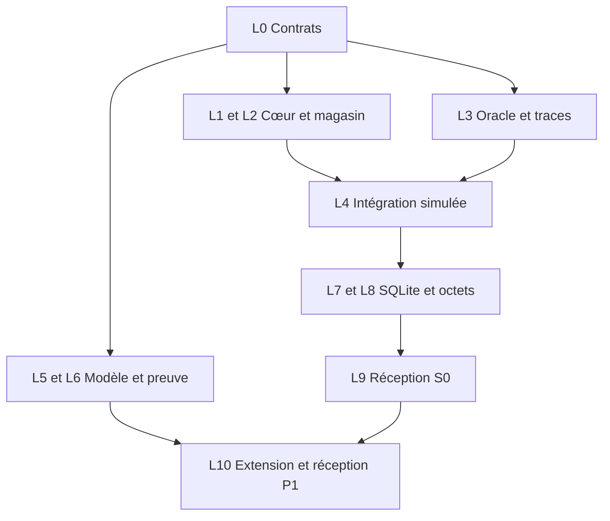

Version de travail 0.1 du 14 novembre 2026.

Le premier lot doit démontrer que mqttiumd conserve les responsabilités acceptées malgré une réponse de stockage perdue, une reconnexion et un redémarrage. Il réalise un chemin complet avec le cœur destiné au produit, un magasin déterministe, SQLite et un transport contrôlé. Les interfaces, formats et critères ci-dessous constituent le contrat de réalisation de ce lot.

Cette version complète les [garanties du chapitre 1](https://chatgpt.com/space/page_a2d3db83cc088191b97e714ae72dd04a), l’[architecture R1 du chapitre 2](https://chatgpt.com/space/page_0c5f2f8425288191bffd4b424906cfac) et le [protocole de validation du chapitre 3](https://chatgpt.com/space/page_c7ad28787ba0819185d9e0edea8d0820). Les exigences DEM identifient les décisions de démarrage. Les signatures et commandes présentées définissent les interfaces du lot à implémenter.

# 1 Résultat attendu du premier lot

**DEM-001 — Livrer une première tranche vérifiable de P1.** La tranche S0 utilise trois sessions persistantes : un producteur et deux destinataires hors ligne, B et C. Le producteur publie en QoS 2 sur un topic exact. Chaque destination obtient une obligation sortante QoS 1. Le routage provient d’une petite table réelle initialisée par la fixture ; les destinations ne sont pas codées dans le résultat du simulateur.

L’admission engage ensemble la publication, les deux obligations, l’état QoS 2 entrant, les comptes associés et le reçu d’opération. Le banc supprime le retour de commit avant sa livraison au cœur, provoque un crash du processus, puis reprend la session. Le client renvoie ce que son propre état MQTT exige. Le broker doit retrouver l’admission existante, émettre PUBREC, puis terminer l’échange après PUBREL sans créer une seconde publication.

À la fin, une admission existe pour l’échange entrant et les deux obligations sont toujours présentes. Le retour perdu n’a ni annulé l’admission ni autorisé un nouveau routage. Les publications sont rendues exécutables dès l’admission selon la méthode QoS 2 retenue au chapitre 2 ; le fait que B et C soient hors ligne masque seulement leur émission.

| Étape | Extension et résultat attendu |
| - | - |
| S0 | Admission atomique, retour perdu, reprise réelle, PUBREC puis PUBCOMP observés sur octets contrôlés |
| S1 | B termine sa livraison, C reste en attente ; résultat tardif et destruction de la session productrice ne recréent ni ne suppriment l’obligation de C |
| P1 complet | Corpus P1-01 à P1-19, échanges sortants QoS 1 et 2, réutilisation des identités, refus, reçus, ressources et preuve pilote |

S0 exclut expiration des messages, Will, retained, filtres wildcard, abonnements partagés et changement d’autorisation. La fixture prépare les sessions et abonnements ; elle ne qualifie pas les branches générales de CONNECT, SUBSCRIBE ou une migration Mosquitto. Ces limites définissent le domaine des assertions, sans réduire les obligations de P1, P2 ou P3.

# 2 Structure initiale du dépôt

**DEM-002 — Séparer les responsabilités avec quatre crates initiales.** Les modules suivent dès le départ les propriétaires logiques de R1. Un propriétaire logique n’impose pas un thread dédié.

| Emplacement proposé | Responsabilité |
| - | - |
| `crates/mqttiumd-contract/` | Identités, commandes, événements, issues et types bornés partagés |
| `crates/mqttiumd-core/` | SessionCore, TopicCore, transitions synchrones, préparations et comptabilité logique |
| `crates/mqttiumd-store-sqlite/` | Transactions, reçus, clôtures, comptes durables et récupération |
| `crates/mqttiumd-lab/` | Magasin déterministe, ordonnanceur, injections et commandes du banc |
| `contracts/schema/v1/` | Schémas de validation des fichiers et traces |
| `contracts/v1/` | Registre des transitions et catalogue des prédicats |
| `tests/scenarios/p1/` | Scénarios déclaratifs et contre-exemples minimisés |
| `tests/fixtures/p1/` | États initiaux produits par une procédure valide |
| `tests/oracle/` | Vérificateur indépendant, initialement en Python |
| `models/m1/` | Modèle TLA+, configurations et correspondance avec le code |
| `proofs/credits/` | Harnais de preuve et inventaire des hypothèses |
| `docs/decisions/` | Décisions d’architecture et changements de contrat |

Ajouter `mqttiumd-codec` lorsque la première vérification sur octets commence, puis `mqttiumd-runtime` pour le runtime réel. Ne créer une crate supplémentaire que si elle impose une frontière de dépendances, de compilation ou de revue utile.

Les tables de transition métier ne connaissent ni SQLite ni le simulateur. Une compilation de simulation réutilise leur code. Un branchement `cfg(simulation)` qui remplace une décision métier est interdit. Les générateurs peuvent partager les types et catalogues ; le calcul de la réponse attendue reste indépendant.

# 3 Compilation et identification des preuves

**DEM-003 — Chaque résultat désigne un contenu et une configuration exacts.** Le bootstrap choisit une version stable de Rust, fixe la toolchain et les dépendances, puis conserve le verrou du workspace. Les profils de compilation, features, paramètres de liaison et options réellement appliqués font partie du manifeste. Le workspace Cargo partage notamment son verrou et ses profils racine ; des options externes peuvent modifier une compilation, d’où leur enregistrement explicite. Voir la [documentation des workspaces](https://doc.rust-lang.org/cargo/reference/workspaces.html) et des [profils Cargo](https://doc.rust-lang.org/cargo/reference/profiles.html).

Le cœur et les contrats propres au projet utilisent `#![forbid(unsafe_code)]`. Une vérification des dépendances et des API interdit au cœur les accès réseau, disque, horloge système, hasard ambiant et runtime asynchrone. Un passage à `no_std + alloc` peut renforcer cette frontière, mais n’est pas une condition préalable de S0.

Les cibles initiales sont Linux x86-64 et ARM64. La compilation x86-64 de référence ne suppose pas AVX2. Les optimisations propres au matériel constituent des profils distincts. SQLite, ses options de compilation et ses bibliothèques associées sont identifiés exactement.

Le manifeste d’une campagne contient au minimum : révision et empreinte du code du broker, du banc et de l’oracle ; état des modifications locales ou archive exacte ; toolchains ; dépendances ; schémas ; fixture ; scénario ; configuration effective ; plateforme ; modèle de panne ; seed et ordonnanceur ; commandes et artefacts.

Pour une contribution GitHub, relire la base, le HEAD et le diff courants via la source distante disponible. Une preuve exécutée sur A ne valide pas un contenu A′ publié ensuite. Toute mutation expérimentale produit son propre identifiant de contenu et ne peut être confondue avec le candidat non modifié.

# 4 Identités et propriété des états

**DEM-004 — Rendre les confusions d’identité difficiles à exprimer.** Les identités sont des types distincts, avec constructeurs contrôlés, comparaison explicite et compteurs vérifiés.

| Type | Rôle |
| - | - |
| `StoreIncarnation` | Espace d’identité du jeu de données |
| `RunEpoch` | Époque durable ouverte avant de nouvelles admissions |
| `LogicalOwnerId` | Propriétaire indépendant du nombre de workers |
| `OperationId` | Incarnation, époque, propriétaire et séquence d’une commande immutable |
| `RequestId` | Demande logique pouvant connaître plusieurs préparations après refus certain |
| `SessionId` | Incarnation d’une session persistante |
| `ConnectionKey` | Session et génération d’une connexion précise |
| `ExchangeId` | Échange MQTT et génération du slot, distincts de son numéro réutilisable |
| `InboundPacketId` et `OutboundPacketId` | Deux espaces de numéros MQTT non nuls |
| `EffectId` | Soumission précise à un adaptateur et résultat correspondant |
| `LeaseKey` | Réservation, compte concerné et génération de réemploi |

Un compteur ne reboucle jamais silencieusement. L’épuisement suspend les admissions concernées et déclenche une procédure définie de renouvellement ou un arrêt explicite.

SessionCore possède l’état d’échange et l’autorisation de répondre au client. TopicCore possède la préparation du routage et les décisions d’admission selon les révisions applicables. StoreCore possède l’application conditionnelle et les faits durables. L’adaptateur possède les opérations d’IO acceptées. Aucun module ne modifie directement l’état mutable d’un autre propriétaire.

Un résultat de stockage portant sur une ancienne connexion peut rester essentiel. Le cœur réconcilie d’abord l’opération durable, puis examine séparément si une réponse est encore autorisée sur la connexion courante. Une garde de génération réseau ne doit pas faire perdre un commit.

# 5 Représentations exactes et structures bornées

**DEM-005 — Définir les encodages et les capacités avant les algorithmes.** Les entiers internes utilisent des tailles explicites. Les identifiants et séquences de 64 bits deviennent des chaînes décimales canoniques dans les fichiers JSON. Les Packet Identifiers restent des entiers compris entre 1 et 65535. Le format JSON ne garantit pas une précision universelle des grands entiers ; la plage d’interopérabilité usuelle décrite par [RFC 8259](https://www.rfc-editor.org/rfc/rfc8259) justifie ce choix.

Dans SQLite, les composantes non signées de 64 bits utilisent des BLOB de huit octets en ordre big endian, avec contrôle du type BLOB et de la longueur. Les comptes utilisant INTEGER sont explicitement limités à l’intervalle signé retenu et validés avant conversion. Aucun passage par REAL ou conversion silencieuse de `u64` vers `i64` n’est admis. SQLite décrit son entier en mémoire comme signé sur 64 bits et conserve les BLOB comme des octets, selon sa [documentation des types](https://www.sqlite.org/datatype3.html).

Les types de capacité rendent visibles les unités : octets de payload physique, références, slots d’échanges, effets, résultats, reçus et continuations. Les limites distinguent données et réserve de contrôle.

Les collections internes exposent une API bornée, pas un `Vec` mutable accessible à tous. Une capacité réservée n’interdit pas à elle seule une réallocation ultérieure : l’API du conteneur doit empêcher le dépassement. Les garanties de [Vec et de ses réservations](https://doc.rust-lang.org/std/vec/struct.Vec.html) servent à implémenter cette API, sans remplacer son contrat.

S0 préalloue ses tables et buffers à partir du profil du banc. Les réservations faillibles précèdent la mutation. Les handles d’arène incluent une génération, ne sont pas des identités durables et ne sont jamais sérialisés comme références de publication. Les payloads ont une propriété immutable partagée ; leur coût physique reste compté jusqu’à la dernière référence, avec un coût distinct pour chaque métadonnée et référence.

# 6 Interface synchrone du cœur

**DEM-006 — Une entrée est appliquée ou restituée intacte.** Le point d’entrée logique reçoit l’état du propriétaire, une entrée possédée, un budget de travail et sa boîte d’effets bornée. Il retourne une issue structurée.

```rust
#[must_use]
pub enum StepOutcome {
    Applied {
        work_used: WorkUnits,
        progress: Progress,
    },
    NeedCapacity {
        input: OwnedInput,
        need: CapacityNeed,
        work_used: WorkUnits,
    },
    Fatal(CoreFault),
}

pub enum Progress {
    Complete,
    WaitingForEffects,
    ContinuationScheduled,
}

pub struct TurnGrant {
    pub work_limit: WorkUnits,
}
```

`NeedCapacity` conserve intégralement l’entrée, l’état métier, les compteurs d’identité, les comptes, les réservations retenues et le contenu de la boîte d’effets. Les réservations provisoires sont rendues. Le travail de planification déjà consommé est déclaré par `work_used` ; il n’est pas présenté comme gratuit.

Une transition suit cinq phases : lire et préparer sans effet externe ; calculer les ressources requises ; les réserver ; appliquer les mutations sans allocation normalement faillible ; publier les effets dans les emplacements réservés. Aucune réentrance ni callback d’adaptateur n’intervient entre ces phases.

Une préparation incrémentale qui conserve un curseur ou un manifeste partiel est une transition appliquée, avec état et continuation comptabilisés. Elle ne peut pas se déclarer `NeedCapacity` après avoir modifié cet état.

`CapacityNeed` indique la ressource, la quantité et la condition de réveil. Une demande supérieure au maximum configuré produit une décision explicite prévue par le protocole ; elle n’attend pas une capacité impossible. Le budget minimum d’une transition indivisible est défini. Une entrée bloquée attend une condition utile, sans boucle de réessai active.

Cette précision complète ARC-004 : `TurnGrant` mesure le travail autorisé. Il ne vaut pas réservation réelle de slots, de mémoire ou de capacité de résultat.

# 7 Conservation et transfert des effets

**DEM-007 — Aucun effet ne disparaît entre la transition et l’adaptateur.** Chaque propriétaire dispose d’une boîte d’effets bornée qui survit aux tours de l’ordonnanceur. La mutation de l’état et l’insertion des effets nécessaires forment une seule transition logique. Un vecteur temporaire abandonné lorsque la file aval est pleine est interdit.

L’adaptateur expose une soumission non bloquante, en dehors du cœur :

```rust
pub enum SubmitResult {
    Accepted,
    NotSubmitted {
        effect: OwnedEffect,
        reason: SubmitBlock,
    },
}

pub trait EffectSink {
    fn try_submit(&mut self, effect: OwnedEffect) -> SubmitResult;
}
```

`NotSubmitted` restitue le même effet possédé et laisse ses réservations valides. Le dispatcher le replace dans son emplacement, sans recréer une commande ou changer son identité. `Accepted` transfère la propriété à l’adaptateur, qui doit en conserver le suivi jusqu’à une issue ou une résolution définie.

La capacité nécessaire au résultat et à son traitement est réservée avant la soumission. Le nombre d’opérations en vol est borné. La saturation des données ne peut pas consommer toute la réserve permettant de recevoir les décisions et de libérer les ressources.

Après `Accepted`, une annulation, un délai dépassé ou une connexion fermée ne signifie pas que l’opération n’a pas eu lieu. Le cœur conserve son état d’opération et sa recette jusqu’à réconciliation. Une demande de résolution peut avoir un nouvel EffectId tout en visant la même OperationId.

La boîte est volatile : un crash la détruit. La sûreté après crash dépend des faits durables et des reprises protocolaires, pas de la conservation implicite de cette mémoire.

# 8 Événements admis et autorité des effets

**DEM-008 — Donner une autorité précise à chaque message interne.** Les unions sont fermées et versionnées aux frontières sérialisées. Tous les champs de taille variable sont bornés ou référencés par un handle comptabilisé.

| Entrée du cœur | Information et autorité |
| - | - |
| `Packet` | Connexion, ordre d’entrée et paquet validé |
| `StoreResult` | EffectId, OperationId et résultat reçu du magasin |
| `FrameResult` | Effet, connexion et progression réellement confirmée par l’adaptateur |
| `WorkAvailable` | Réveil sans autorité de créer une obligation |
| `Deadline` | Token et temps explicites |
| `Continue` | Continuation possédée et budget |
| `Recovery` | Page bornée issue des données durables |

| Effet | Responsabilité transférée |
| - | - |
| `Persist` | Proposer une commande figée |
| `ResolveAndFence` | Réconcilier une opération et établir, si possible, une clôture sûre |
| `LoadWork` | Lire une page cohérente d’obligations existantes |
| `EmitFrame` | Émettre une trame précise sur une génération de connexion |
| `CloseConnection` | Fermer la connexion désignée |
| `ArmDeadline` | Programmer un token d’échéance |
| `Continue` | Réexécuter un travail déjà compté |

Ces objets ne contiennent ni future, ni socket, ni fermeture exécutable, ni pointeur mutable vers un autre propriétaire. Le décodeur traite les octets invalides avant de construire un paquet validé ; un scénario malformé utilise des octets, sans fabriquer un état impossible dans une énumération interne.

Une notification perdue ne détruit pas le travail : le registre durable reste l’autorité et un parcours équitable borné peut le redécouvrir. Une notification dupliquée ne crée rien. Une progression de trame ne prouve pas que le pair a reçu un paquet complet.

# 9 Recettes immutables et identité des commandes

**DEM-009 — Une OperationId désigne exactement une recette.** La recette figée contient son format, son opération, les préconditions, la source et son échange, les révisions applicables, la liste bornée des cibles, les coûts et les références durables du payload.

Le propriétaire conserve une référence immutable à cette recette jusqu’à résolution. Une enveloppe privée autour d’un partage de type Arc peut convenir, à condition de ne pas exposer de mutation intérieure ou de modification par copie. Arc fournit une propriété partagée, mais son API permet aussi plusieurs formes de mutation ; l’immuabilité est donc un contrat de l’enveloppe, conformément à la [documentation Rust](https://doc.rust-lang.org/std/sync/struct.Arc.html).

Pour P1, le magasin conserve une représentation canonique exacte de la recette et compare cette représentation lors des répétitions. Les références de payload désignent des objets immutables maintenus pendant la fenêtre nécessaire. Une empreinte accélère éventuellement une recherche ; elle ne remplace pas le contrôle exact d’égalité du contrat initial.

Une nouvelle présentation de la même OperationId avec une recette différente est une violation interne, sans second effet. Après refus certain, une nouvelle préparation obtient une autre OperationId tout en conservant la demande logique et ses contraintes d’ordre. Après issue indéterminée, modifier les cibles, les coûts ou le payload sous l’ancienne identité est interdit.

La conservation des recettes et reçus possède un budget. Si l’origine ne confirme plus, elle subit une limitation ; le magasin n’efface pas arbitrairement les informations requises pour dédupliquer. La collecte de P1 complet conserve une clôture empêchant toute exécution ultérieure d’une ancienne identité.

# 10 Issues du stockage et clôture des opérations

**DEM-010 — Une absence observée ne vaut pas refus définitif.** Une commande peut être encore dans une file alors qu’une lecture ne trouve aucun reçu. Transformer cette absence en rejet autoriserait une nouvelle tentative pendant que l’ancienne reste exécutable.

| Issue | Signification contractuelle |
| - | - |
| `Committed` | L’effet durable et son résultat sont établis pour cette recette |
| `RejectedCertain` | Aucun effet de cette opération n’a été engagé et toute exécution ultérieure de cette identité est interdite |
| `PendingOrUnknown` | Les observations ne permettent pas de conclure |
| `RetiredOutcomeUnavailable` | L’identité est définitivement non exécutable ; le détail historique de son résultat n’est plus disponible |

`ResolveAndFence` est ordonné avec l’application des commandes par le writer. Si l’opération est engagée, il retourne son résultat. Si elle est absente d’un espace encore ouvert, il peut établir atomiquement une clôture durable avant d’annoncer un refus certain. Si l’identité appartient à un espace déjà collecté et fermé, il ne prétend pas connaître un ancien résultat supprimé. S’il ne peut pas établir cette clôture, il conserve une issue inconnue.

La réponse ne se contente pas d’un champ `closed: true` : le test remet réellement l’ancienne commande en circulation et observe son rejet sans effet. Une lecture sur un autre snapshot ne peut pas autoriser l’exécution ou sa clôture.

Les connaissances sont monotones. Une réponse ancienne `PendingOrUnknown` ne fait pas régresser un résultat terminal établi. Une réponse après collecte ne rouvre rien. Deux résultats terminaux contradictoires pour la même recette constituent une faute interne, avec arrêt et diagnostic.

Un refus doit rester refusé après libération de quota. Si une panne du stockage empêche d’enregistrer durablement une clôture, le système ne promet pas une certitude qu’il ne possède pas. Une fermeture d’époque au redémarrage interdit les exécutions anciennes ; elle ne transforme pas à elle seule les résultats historiques inconnus en rejets.

# 11 Première réalisation SQLite

**DEM-011 — Réaliser les frontières logiques dans une seule transaction.** La référence initiale utilise un fichier de base, un writer et le mode WAL avec synchronisation FULL. Les valeurs effectives sont relues et enregistrées ; une configuration demandée n’est pas une preuve qu’elle s’applique. Les garanties matérielles restent celles du modèle de panne déclaré. Voir la [documentation WAL](https://www.sqlite.org/wal.html) et le [paramètre synchronous](https://www.sqlite.org/pragma.html#pragma_synchronous).

| Ensemble initial | Contenu et contrainte principale |
| - | - |
| Métadonnées | Format, incarnation, époque, état des espaces d’identité |
| Sessions et routes exactes | Sessions persistantes et cibles de la fixture |
| Opérations | Identité unique, recette exacte, décision et reçu |
| Clôtures | Identités ou intervalles définitivement non exécutables |
| Publications et payloads | Objet immutable et références durables |
| Obligations | Publication, destination, cause, QoS effectif, phase et coûts |
| Échanges entrants | Session, PacketId, ExchangeId, publication et phase |
| Comptes | Utilisation, réservations, limites et contrôle |

`AdmitPublication` vérifie les préconditions, les identités, les révisions de session et les capacités, puis engage publication, payload, obligations, état entrant, comptes et reçu ensemble. Un échec de garde ne laisse aucun sous-ensemble admis. La terminaison entrante après PUBREL possède sa propre commande conditionnelle et durable avant autorisation de PUBCOMP.

Les commandes de résolution, de changement d’époque et de collecte utilisent le même ordre d’autorité. Les lectures paginées n’introduisent pas une seconde autorité d’écriture. Les transactions SQLite n’autorisent qu’un writer simultané ; leur comportement et les snapshots de lecture sont documentés dans les [transactions SQLite](https://www.sqlite.org/lang_transaction.html).

Les identifiants BLOB sont contrôlés par type et longueur. Un incrément se fait par décodage en Rust, `checked_add`, puis écriture conditionnelle du nouvel encodage. Une addition SQL sur un BLOB est interdite.

Aucune suppression en cascade depuis la session productrice ne peut supprimer les obligations d’autres sessions. Une terminaison liée à la destination passe par sa cause explicite et son compte. Les causes restent inspectables dans l’oracle.

Les erreurs sont classées d’après les faits observés. Le mode autocommit ne suffit pas à distinguer un commit achevé d’un rollback achevé : les deux réactivent ce mode. La réconciliation utilise les reçus et l’état durable, selon la [documentation sqlite3_get_autocommit](https://www.sqlite.org/c3ref/get_autocommit.html).

S0 n’ajoute ni stockage réparti, ni transaction multi-base, ni batching complexe. Ces optimisations attendent un coût mesuré et conservent le même contrat de rejeu.

# 12 Reprise sans mémoire cachée du banc

**DEM-012 — Reconstruire uniquement ce que le produit peut connaître.** Le crash du processus détruit propriétaires, boîtes d’effets, files internes, sockets, corrélations, handles et préparations volatiles. Le collecteur de preuves et les clients simulés appartiennent à des domaines de panne distincts.

Le redémarrage ouvre et vérifie le magasin, ferme les espaces anciens selon la procédure, puis établit durablement une nouvelle époque avant de nouvelles admissions. La récupération lit des pages bornées selon une vue cohérente ou une frontière de révision explicite. Les admissions restent fermées pendant la phase qui l’exige.

L’inventaire récupère les sessions, les slots entrants, les phases, les publications et obligations ainsi que les décisions nécessaires. Les identités retrouvées proviennent de ces données. Une simple lecture de test ayant retenu `op_A` n’autorise pas le harnais à fournir cet identifiant au broker.

Si une admission a été engagée, le slot entrant relie la reprise cliente à la publication existante. Si rien n’a été engagé, le payload et la recette préparée ont pu disparaître ; le rejeu normal du client permet alors une nouvelle préparation dans la nouvelle époque. Il ne faut pas reconstruire artificiellement une recette inexistante à partir du journal de l’oracle.

Les effets durables d’une ancienne époque sont réconciliés même si de nouvelles commandes anciennes sont interdites. Une fermeture d’époque est une règle d’exécution, pas un effacement des responsabilités.

S0 utilise un client qui n’a observé aucun PUBREC avant la panne : il reprend par son PUBLISH QoS 2 avec le numéro initial. P1-03 vérifie séparément le client ayant déjà reçu PUBREC et qui ne renvoie que PUBREL.

# 13 Simulateur et modèle de panne

**DEM-013 — Contrôler les choix sans remplacer les décisions du cœur.** Le simulateur pilote les entrées, les disponibilités de capacité, les horaires explicites, les commandes retardées, les résultats et les octets du transport. Les mêmes fonctions métier s’exécutent ensuite sur SQLite.

Une seed seule ne suffit pas à rejouer une exécution. Chaque choix conserve la version de l’ordonnanceur, l’ensemble des actions éligibles ou son empreinte vérifiable, l’identité stable de l’action choisie et ses paramètres. Une position dans l’itération non spécifiée d’une table de hachage n’est pas une identité d’action.

Le magasin simulé distingue état durable, transaction en préparation, commande en transit et résultat prêt. Une injection peut couper avant application, après engagement, avant remise du résultat ou pendant sa consommation. Les points d’injection nommés sont contractuels et leur activation effective est enregistrée.

Le modèle initial est le crash de processus. La variante SQLite tue effectivement le processus broker depuis un superviseur extérieur, puis rouvre la base avec un nouveau processus. Ce résultat ne vaut pas essai de coupure électrique : le noyau et le cache du système peuvent avoir survécu.

Les fautes de synchronisation, écritures partielles, corruption et panne matérielle suivent les modèles et campagnes du chapitre 3. Une simulation d’échec d’appel ne démontre pas à elle seule le comportement d’un support après perte d’alimentation.

Les limites de pas, temps, mémoire et trace sont explicites. Si elles empêchent d’atteindre un point nécessaire ou de conserver une preuve, le résultat est inconclusif.

# 14 Schémas versionnés et validation des fichiers

**DEM-014 — Fermer les formats dès leur première version.** Les documents JSON portent `format` et `schema_version`. Les objets sont fermés, les variantes ont un discriminateur `kind` avec valeur constante et les références de schéma sont locales. Les versions ou champs inconnus produisent une erreur.

| Fichier proposé | Objet |
| - | - |
| `contracts/schema/v1/primitives.schema.json` | Identités, bornes, encodages et empreintes |
| `contracts/schema/v1/scenario.schema.json` | Préconditions, étapes, injections et assertions |
| `contracts/schema/v1/trace-record.schema.json` | Enveloppes et variantes de trace |
| `contracts/schema/v1/transition-registry.schema.json` | États, partitions de gardes et couverture |
| `contracts/schema/v1/run-manifest.schema.json` | Contenu et configuration d’une exécution |
| `contracts/schema/v1/run-result.schema.json` | Verdict, raisons et inventaire des preuves |

Le socle suit [JSON Schema 2020-12](https://json-schema.org/draft/2020-12/json-schema-core). Une seconde validation sémantique contrôle les références, limites, causalités et règles de couverture. Une annotation de format ne remplace pas une assertion effectivement appliquée par le validateur, comme le distingue la [spécification de validation](https://json-schema.org/draft/2020-12/json-schema-validation).

Fragment du schéma des primitives :

```json
{
  "$defs": {
    "u64": {
      "type": "string",
      "pattern": "^(0|[1-9][0-9]{0,19})$",
      "maxLength": 20
    },
    "sha256": {
      "type": "string",
      "pattern": "^[0-9a-f]{64}$"
    },
    "packet_id": {
      "type": "integer",
      "minimum": 1,
      "maximum": 65535
    }
  }
}
```

La validation sémantique impose aussi `u64 <= 18446744073709551615`. Elle vérifie la chaîne entière et refuse signe, zéros initiaux, décimales, espaces, retours à la ligne et débordement. Les clés JSON dupliquées sont rejetées pendant le parsing, avant qu’une bibliothèque écrase une valeur. Les payloads utilisent des octets encodés ou des blobs locaux référencés par longueur et empreinte ; aucune normalisation Unicode implicite n’est permise.

L’empreinte des octets exacts du fichier identifie la preuve. Une empreinte JSON canonique peut s’ajouter selon [RFC 8785](https://www.rfc-editor.org/rfc/rfc8785), avec implémentation conforme : trier les clés à la manière de `sort_keys=True` ne suffit pas dans tous les cas. Les tableaux conservent leur ordre. Les schémas ne sont jamais téléchargés pendant un run.

JSON est normatif en version 1. Un format YAML d’édition peut être ajouté ensuite par conversion stricte, sans coercitions implicites.

# 15 Registre des transitions

**DEM-015 — Rendre la couverture mécanique sans partager l’algorithme de décision.** Le registre `contracts/v1/p1.transitions.json` décrit chaque combinaison pertinente de machine, classe d’état, classe d’événement et partition de garde.

| Champ | Obligation |
| - | - |
| `machine`, `state_class`, `event_class` | Références à des catalogues fermés |
| `guard_partition` | Partition finie de prédicats définis et vérifiables |
| `disposition` | TRANSITION, DEFER, IGNORE_STALE, REJECT, CLOSE ou UNREACHABLE |
| `next_state_class` | Classe après application ou conservation explicite |
| `required_effects` | Effets et préconditions attendus |
| `forbidden_effects` | Effets interdits |
| `resource_delta_class` | Réservation, transfert, libération ou absence de changement |
| `requirements` | Exigences des chapitres précédents et de ce lot |
| `witnesses`, `mutations` | Témoins positifs, négatifs et mutants associés |

Une garde n’est pas une phrase libre que le contrôleur ne peut interpréter. Le catalogue définit ses valeurs et leur sens : identité courante ou périmée ; résultat terminal ou inconnu ; capacité suffisante ou insuffisante ; recette identique ou différente.

Les partitions sont disjointes et couvrent leur domaine déclaré. Une combinaison UNREACHABLE possède une justification et un témoin de la précondition qui l’exclut. Une classe globale « autres événements ignorés » n’efface pas un trou de la machine.

Exemple conceptuel : dans AdmissionPending, un StoreResult Committed de la bonne opération autorise la projection vers AwaitPubrel et la préparation de PUBREC, sous capacité réservée. Le même résultat avec capacité d’effets insuffisante restitue l’entrée intacte. Une réponse Unknown tardive sur une opération déjà résolue conserve la connaissance terminale.

Le registre fournit les obligations de test et le vocabulaire partagé. Il ne génère pas simultanément les décisions du cœur et les réponses attendues de l’oracle à partir du même corps d’action.

# 16 Traces et niveaux d’observation

**DEM-016 — Conserver la causalité et distinguer connaissance et réalité.** Une trace JSON Lines possède un en-tête, des enregistrements versionnés et un pied déclarant le nombre d’enregistrements et la complétude. Son empreinte exacte figure dans l’inventaire externe des artefacts, sans auto-empreinte récursive.

L’enveloppe comprend `run_id`, `record_sequence`, `origin_component`, `origin_incarnation`, `origin_sequence`, `causal_parents`, `time_domain`, `time_value`, `kind` et `payload`, en plus du format et de sa version. Les grands compteurs et temps sont des chaînes canoniques.

| Événement | Ce qu’il établit |
| - | - |
| `CommandSubmitted` | L’adaptateur a pris la commande en charge |
| `StoreCommitStable` | L’engagement est établi dans le modèle de panne déclaré |
| `StoreResultReady` | Le résultat est disponible côté magasin |
| `StoreResultDelivered` | Le cœur a reçu ce résultat |
| `FrameEligible` | La machine autorise une trame |
| `FrameWriteProgress` | Une progression d’écriture précise est confirmée |
| `PeerPacketObserved` | Un décodeur indépendant côté pair a reçu un paquet complet |
| `FaultHit` | L’injection annoncée a effectivement été atteinte |
| `BrokerCrashed` et `BrokerRecovered` | Les frontières du domaine de panne sont observées |

Les observations cachées du stockage appartiennent à un canal de preuve séparé, avec des types non admis comme entrées du cœur. Un drapeau de visibilité sur un événement générique ne suffit pas à garantir cette séparation.

Dans le simulateur, l’ordre total d’exécution est connu. En exécution réelle, l’ordre d’arrivée au collecteur n’est pas une causalité universelle : les séquences par origine et les liens de dépendance priment. L’oracle ne déplace pas un événement avant son prérequis pour rendre une trace acceptable.

Le collecteur survit au crash du broker. Il ne supprime pas silencieusement les événements nécessaires à la décision. Trace tronquée, numéro manquant ou budget saturé rendent la conclusion correspondante inconclusive. Les logs de confort peuvent être échantillonnés ; les preuves décisives ne le sont pas.

# 17 Scénario initial de perte du résultat de commit

**DEM-017 — Fixer P1-02 comme première démonstration complète.** La fixture `three-persistent-sessions.json` crée le producteur, B et C, les routes exactes et les capacités nécessaires. Les destinataires restent hors ligne et persistants pendant toute la trace, sans reset, expiration, révocation ou changement d’abonnement. Le profil n’utilise aucun Will.

Le scénario suivant fixe la forme attendue du futur fichier. Les valeurs de budget sont des limites de banc pour ce petit cas, pas des limites de production.

```json
{
  "format": "mqttiumd.scenario",
  "schema_version": 1,
  "id": "P1-02",
  "profile": "p1-durable-mqtt5-without-expiry",
  "initial_fixture": "tests/fixtures/p1/three-persistent-sessions.json",
  "budgets": {
    "max_steps": "4096",
    "max_trace_bytes": "16777216"
  },
  "faults": [{
    "id": "lost_admission_result",
    "point": "store.result.ready",
    "match": {
      "command_kind": "AdmitPublication",
      "publication_binding": "pub_A"
    },
    "occurrence": "1",
    "action": "drop_result",
    "bind_operation_as": "op_A",
    "expected_hits": "1"
  }],
  "steps": [
    {
      "kind": "ClientResumeSession",
      "client": "producer",
      "expect_session_present": true,
      "max_steps": "512"
    },
    {
      "kind": "ClientPublish",
      "client": "producer",
      "topic": "p1/example",
      "qos": 2,
      "retain": false,
      "packet_id": 7,
      "payload_hex": "7061796c6f6164",
      "bind_exchange_as": "pub_A"
    },
    {
      "kind": "DriveUntil",
      "event": "FaultHit",
      "binding": "lost_admission_result",
      "max_steps": "512"
    },
    {
      "kind": "InspectDurableState",
      "checkpoint": "after_commit_before_crash"
    },
    {
      "kind": "CrashBroker",
      "failure_model": "process"
    },
    {
      "kind": "RestartBroker",
      "workers": 1
    },
    {
      "kind": "ClientResumeSession",
      "client": "producer",
      "expect_session_present": true,
      "max_steps": "512"
    },
    {
      "kind": "ClientResumeExchange",
      "client": "producer",
      "exchange": "pub_A"
    },
    {
      "kind": "DriveUntil",
      "event": "PeerPacketObserved",
      "client": "producer",
      "packet_kind": "PUBREC",
      "packet_id": 7,
      "max_steps": "512"
    },
    {
      "kind": "ClientSendPubrel",
      "client": "producer",
      "packet_id": 7
    },
    {
      "kind": "DriveUntil",
      "event": "PeerPacketObserved",
      "client": "producer",
      "packet_kind": "PUBCOMP",
      "packet_id": 7,
      "max_steps": "512"
    },
    {
      "kind": "InspectDurableState",
      "checkpoint": "final"
    }
  ],
  "assertions": [
    "one_admission_per_observed_inbound_exchange",
    "same_required_obligations_at_both_checkpoints",
    "same_recipe_for_op_A",
    "no_positive_ack_before_confirmed_commit",
    "no_pubrec_observed_before_crash",
    "all_required_faults_hit",
    "trace_complete"
  ]
}
```

L’étape ClientResumeSession est une macro versionnée : envoyer CONNECT pour la session préparée, puis avancer dans sa limite de pas jusqu’à un CONNACK de succès avec Session Present. ClientResumeExchange utilise ensuite seulement l’état du client. Au point FaultHit, une barrière du banc suspend la progression de l’opération jusqu’à l’inspection puis au crash ; aucune résolution implicite ne s’intercale pour produire PUBREC. L’inspection est en lecture seule et ne force pas de checkpoint.

Les bindings `pub_A` et `op_A` sont des références du scénario et de l’oracle. Ils ne deviennent jamais des informations de récupération fournies au broker. Le client rejoue selon ses paquets observés, sans consulter le magasin.

Aux deux checkpoints, comparer les DeliveryId, SessionId cibles, causes, QoS effectif et référence du payload. Le compte égal à deux ne suffit pas. L’unicité est mesurée par échange identifié indépendamment par le client et l’oracle ; un ExchangeId fraîchement créé par erreur ne remet pas ce compteur à zéro.

La reprise cliente vérifie le sous-ensemble CONNECT et CONNACK nécessaire à cette session déjà préparée, puis les octets PUBLISH, PUBREC, PUBREL et PUBCOMP. Elle ne qualifie pas les autres branches de connexion ou d’abonnement.

# 18 Scénarios de clôture et mutations du premier lot

**DEM-018 — Tester la commande retardée après une lecture absente.** QABS complète P1-02 avec une course sans crash. Le banc conserve une commande avant son entrée dans le writer, observe son absence en lecture, puis entrelace sa livraison avec ResolveAndFence.

| Scénario | Ordre contrôlé | Résultat exigé |
| - | - | - |
| QABS-A | Lecture absente, puis engagement de la commande avant la clôture | Résolution Committed et un seul effet |
| QABS-B | Lecture absente, puis engagement de la clôture avant livraison de la commande | Refus certain et aucun effet ultérieur |
| QABS-C | Commande encore retenue, aucun commit connu et clôture impossible à établir | Issue inconnue ; aucun refus certain inventé |

Dans QABS-A, la commande est libérée avant l’engagement de la clôture. Dans QABS-B, elle l’est après. Attendre la clôture dans les deux tests ne couvrirait qu’un ordre.

Le premier lot reprend MU-01, MU-02, MU-03, MU-17 et MU-25 du chapitre 3 sur les chemins qu’il implémente. Il ajoute des identifiants locaux, sans renuméroter les vingt-cinq mutations existantes :

| Mutation locale | Faute qui doit être détectée |
| - | - |
| DEM-MU-01 | Absence lue transformée en rejet définitif sans clôture |
| DEM-MU-02 | Perte d’un effet quand le dispatcher rencontre une file pleine |
| DEM-MU-03 | Réinjection de l’OperationId mémorisée par le banc lors de la reprise |
| DEM-MU-04 | Nouvelle admission cachée derrière un nouvel ExchangeId au rejeu |
| DEM-MU-05 | Résultat Unknown tardif remplaçant un résultat terminal |
| DEM-MU-06 | Deux obligations conservées mais destination ou cause modifiée |

Chaque mutant possède un témoin attendu, une faute atteinte et un oracle qui échoue pour cette raison. Une compilation cassée ou un timeout non expliqué ne compte pas comme détection de la propriété.

# 19 Oracle indépendant et assertions

**DEM-019 — Vérifier les histoires observées avec une logique distincte.** L’oracle initial en Python lit les traces, les snapshots et les paquets décodés. Il ne réutilise ni le moteur de transitions Rust ni son calcul de routage ou de résultat attendu.

Il possède sa propre identité d’échange client. Dans S0, la session persistante et le Packet Identifier 7 restent associés au même échange jusqu’à sa terminaison. Dans les scénarios de réutilisation, l’oracle avance selon l’histoire protocolaire observée, sans adopter aveuglément une génération annoncée par le broker.

Ses assertions portent sur l’admission unique, la conservation des obligations identifiées, l’absence de succès anticipé, l’immuabilité de recette, la non-exécution d’un refus clôturé, la monotonie de connaissance et les comptes. Elles vérifient les effets interdits aussi bien que les effets attendus.

La vérité cachée du magasin permet de juger le résultat, mais ne peut pas justifier à elle seule une réponse du cœur. Un PUBREC est prématuré si le cœur n’avait pas reçu une confirmation ou récupéré un fait durable suffisant, même si le magasin avait effectivement engagé la transaction.

Le contrôleur de trace accepte plusieurs entrelacements lorsque le contrat les autorise. Il respecte les ordres locaux et les causes ; il ne réduit pas arbitrairement l’oracle à une unique trace de référence. Une absence de données requises reste inconclusive.

Les lecteurs de JSON, le décodeur indépendant et l’oracle ont leurs propres cas invalides et tests de mutation. Un corpus de trames fixé manuellement selon le protocole complète les essais aller-retour, qui pourraient partager une même erreur d’encodage et de décodage.

# 20 Premier modèle de concurrence

**DEM-020 — Construire M1a avant d’élargir le modèle.** M1a examine l’admission et l’autorisation de PUBREC pour un producteur, deux destinations, deux publications possibles, deux identités d’admission et au plus un crash. Il n’inclut initialement ni collecte, ni expiration, ni Will. M1b ajoute resets, générations de session, refus de capacité, clôtures et changement d’époque.

Les domaines finis sont consommés sans rebouclage artificiel. Épuiser les deux identités suspend une nouvelle création ; cela ne supprime pas une commande retardée. Le rapport annonce ces bornes. Les phases PUBREL et PUBCOMP reçoivent ensuite leur couverture dans M2 ; M1a ne prétend pas prouver tout le chemin S0.

| Domaine | Variables représentatives |
| - | - |
| Durable | Recettes, décisions, publications, obligations, slots entrants, comptes, époques et clôtures |
| Volatile | Préparations, connaissance Pending ou Unknown, résultats connus, réservations et corrélations |
| Transport interne | Commandes en attente et résultats prêts ou perdus |
| Connexions | Génération, état ouvert et demandes de réponse |
| Transport externe | Trames autorisées, soumises et observées |
| Historique du vérificateur | Admissions et échanges indépendants, observations du pair, fautes atteintes |

Les variables du vérificateur ne figurent jamais dans les gardes du produit. Le crash efface le domaine volatile annoncé. La reprise inspecte les données durables ; elle ne lit pas cet historique.

Les actions initiales comprennent réception, préparation, soumission, retard de commande, engagement, refus, livraison ou perte du résultat, timeout, résolution, autorisation et observation de PUBREC, crash et récupération. M1b introduit explicitement la course entre clôture et application.

Les invariants relient l’admission unique à l’échange indépendant, l’atomicité aux deux obligations, la réponse à la connaissance disponible, la recette à son identité, la clôture à la non-exécution future et les comptes à leurs objets. Ils distinguent état courant et faits historiques lorsque la collecte sera ajoutée.

L’atomicité de ApplyCommit est une hypothèse du modèle logique. Le magasin SQLite doit réaliser cette frontière dans les tests d’intégration ; le modèle ne prouve pas SQLite ou le matériel.

TLC peut explorer les états et propriétés du modèle, comme le décrit la [documentation TLA+](https://lamport.azurewebsites.net/tla/tools.html). Chaque campagne conserve modèle, configuration, version outil, états explorés, bornes et contre-exemples. Les invariants de sûreté ne reposent pas sur une hypothèse d’équité ajoutée pour supprimer une mauvaise trace.

La vivacité fait l’objet d’une propriété distincte, avec hypothèses explicites : fin des crashes, magasin disponible, ordonnanceur équitable et reprise utile du client. Des témoins de non-vacuité montrent réellement un engagement, une perte de résultat, une issue inconnue, un refus, un crash après commit et une récupération. Les scénarios du simulateur sont reliés aux actions du modèle par une table de correspondance.

# 21 Preuve pilote sur une fonction exécutée

**DEM-021 — Prouver une libération exacte sans mutation partielle.** La fonction pilote est `release_if_current`, utilisée par le code réel pour libérer une réservation. Elle reçoit un enregistrement de lease, un compte et une clé de libération.

La réservation contient son identité complète, sa génération, le compte concerné, son coût en octets et en slots, ainsi que son état Held ou Released. Le compte porte les utilisations et limites correspondantes.

| Condition | Résultat requis |
| - | - |
| Clé périmée | Aucune mutation |
| Répétition d’une libération achevée | Aucune seconde soustraction |
| Mauvais compte | Erreur explicite, aucun changement |
| Coût supérieur à une utilisation | Erreur explicite, aucun changement des deux dimensions |
| Clé courante et compte cohérent | Soustraction exacte des octets et slots, puis état Released |
| Ancienne clé après réemploi du slot | Nouvelle réservation inchangée |

Les deux soustractions sont vérifiées avant toute mutation. La fonction n’alloue pas et n’effectue aucune IO. La propriété de préservation `used <= limit` suppose un préétat cohérent ; des harnais séparés couvrent les comptes incohérents et vérifient leur branche sans mutation.

Le premier harnais Kani appelle le corps de production avec des valeurs symboliques, y compris les limites des entiers. Cette fonction sans boucle n’exige pas de prétendre explorer une quantité non bornée d’itérations. Les hypothèses ne doivent pas exclure tous les chemins d’erreur. La documentation des [premiers harnais Kani](https://model-checking.github.io/kani/tutorial-first-steps.html), de ses [limites Rust](https://model-checking.github.io/kani/rust-feature-support.html) et du [déroulage des boucles](https://model-checking.github.io/kani/tutorial-loop-unwinding.html) encadre les garanties annoncées.

Un essai Verus porte sur la même définition exécutable, organisée pour être réellement utilisée par le produit. Une copie manuelle « équivalente » ne remplit pas l’exigence. L’essai documente les adaptations et restrictions de langage selon les [fonctionnalités supportées](https://verus-lang.github.io/verus/guide/features.html). Un outil inadapté peut être écarté avec justification ; l’obligation de preuve pilote subsiste.

Le dossier comprend les propriétés, le contenu exact du corps, les préconditions, les fonctions supposées ou exclues, la configuration, les résultats et les mutants. Une modification ordinaire du coût ou de la structure est réalisée pour mesurer le coût de maintenance de la preuve.

Cette preuve protège le calcul et les gardes. Elle ne prouve pas que l’appel intervient au bon moment du protocole : MU-05 et les traces d’intégration doivent toujours détecter une libération QoS prématurée.

# 22 Codec et transport contrôlé

**DEM-022 — Faire passer les observations réseau par des octets.** La première étape sans codec peut vérifier l’état durable et FrameEligible. Le passage de S0 exige ensuite un codec limité, un transport en mémoire contrôlable et un décodeur de pair indépendant.

Le sous-ensemble couvre la reprise de session préparée par CONNECT et CONNACK, puis PUBLISH QoS 2, PUBREC, PUBREL et PUBCOMP. Les propriétés et options admises sont fixées par le profil, avec rejet explicite des variantes non implémentées. Les destinataires restent hors ligne ; cette tranche ne valide donc pas leur machine d’émission QoS 1.

Le banc fragmente chaque trame, groupe plusieurs fragments et contrôle les retours d’écriture. Le curseur avance seulement pour les octets dont la progression est confirmée. Un paquet complet n’existe pour l’oracle qu’après décodage côté pair.

Les essais minimaux incluent troncature, Remaining Length invalide, taille au maximum et au-delà, Packet Identifier nul lorsqu’il est interdit, flags incorrects et propriétés inadmissibles dans le sous-ensemble. Un rejet ne doit pas déclencher une allocation proportionnelle à une taille non validée. Les premiers harnais de fuzzing visent le décodage des octets, les lecteurs de formats du banc et les suites d’événements valides soumises au cœur. Les entrées arbitraires passent par les validateurs ; elles ne fabriquent pas des valeurs internes impossibles. Les seeds minimisées, budgets, couverture et échecs sont conservés selon V3-020 et V3-026.

Ce transport qualifie l’interface et le flux contrôlé. TCP, TLS, fermetures système, annulation asynchrone et progression sous backpressure restent les essais de P3. Le runtime réel réutilise le cœur et le contrat de progression ; il ne reprend pas les raccourcis de contrôle du banc.

# 23 Interface du banc et verdicts

**DEM-023 — Une campagne produit un résultat explicite et ses preuves.** Les commandes suivantes sont les interfaces à réaliser, pas des commandes déjà disponibles.

```text
mqttiumd-lab validate --contracts contracts/v1 --scenario tests/scenarios/p1/P1-02.json
mqttiumd-lab run --backend sim-store --scenario tests/scenarios/p1/P1-02.json --out runs/p1-02
mqttiumd-lab run --backend sqlite --scenario tests/scenarios/p1/P1-02.json --out runs/p1-02-sqlite
mqttiumd-lab replay --mode exact --run runs/p1-02
mqttiumd-lab replay --mode regression --run runs/p1-02 --target candidate
mqttiumd-lab minimize --run runs/p1-02-failed
```

Le rejeu exact utilise le contenu et les versions d’origine, puis vérifie les choix enregistrés. Le rejeu de régression applique le même scénario causal et les mêmes propriétés à un nouveau candidat. Si un point indispensable n’est plus atteint, il ne déclare pas une correction sans examiner le changement du contrat.

| Verdict | Code de sortie | Sens |
| - | - | - |
| PASS | 0 | Toutes les obligations du périmètre annoncé sont satisfaites avec preuves suffisantes |
| FAIL | 1 | Une propriété du contrat est violée avec témoin exploitable |
| INCONCLUSIVE | 2 | Configuration invalide, preuve manquante, injection non atteinte ou limite empêchant de conclure |
| OUT_OF_SCOPE | 3 | Propriété explicitement hors du profil demandé |

Une propriété obligatoire ne devient pas hors périmètre par manque d’implémentation. Un lancement de S0 sans codec ne passe pas S0 ; il peut produire un résultat sur son sous-périmètre de cœur seulement. Au niveau d’une suite, un FAIL établi subsiste même si une autre assertion est inconclusive ; une assertion obligatoire inconclusive bloque le passage.

Chaque répertoire de campagne contient manifeste, résultat, trace, choix d’ordonnancement, snapshots, résultats de mutations et inventaire des artefacts. Le résultat donne le périmètre, les raisons, l’état de chaque assertion, les injections atteintes et les empreintes. Les sorties existantes ne sont pas écrasées silencieusement.

La minimisation conserve la propriété violée, les préconditions et les points de faute utiles. Le contre-exemple minimisé rejoint le corpus après revue ; l’original reste identifiable.

# 24 Lots de travail et dépendances

**DEM-024 — Découper par contrat et résultat vérifiable.** Chaque lot possède un périmètre de fichiers, un propriétaire d’intégration et une réception indépendante. Les dépendances ci-dessous organisent le premier chemin ; elles ne fixent pas un calendrier artificiel avant les résultats.

| Lot | Dépendances | Livraison et réception |
| - | - | - |
| L0 Contrats | Aucune | Types, schémas, primitives, catalogue de fautes et profils ; cas invalides et frontières numériques rejetés correctement |
| L1 Cœur entrant | L0 | Admission et terminaison QoS 2 du périmètre ; NeedCapacity à chaque frontière sans mutation ni perte d’entrée |
| L2 Magasin déterministe | L0 | Commandes, quatre issues, clôtures et récupération ; QABS-A, B et C discriminants |
| L3 Oracle et traces | L0 | Lecteur indépendant, causalité, identité d’échange propre et complétude ; traces bonnes et fautives distinguées |
| L4 Intégration simulée | L1, L2, L3 | P1-02 sans octets, saturation d’outbox et résultat tardif ; rejeu exact et contre-exemple minimisé |
| L5 Modèle M1 | L0 puis correspondance L4 | M1a, extension M1b, non-vacuité, invariants et mutations ; limites publiées |
| L6 Fonction et preuve | L0, interface L1 | Fonction utilisée, harnais, erreurs sans mutation, mutants et essai de maintenance |
| L7 SQLite | L0, contrat L2 stabilisé | Transactions et récupération ; parité du contrat et erreurs classées sans faux refus |
| L8 Codec contrôlé | L0, L1, L3 | Octets de reprise et QoS 2, décodeur indépendant, fuzzing, trames invalides et fragmentation |
| L9 Réception S0 | L4, L7, L8 | Même scénario sur les deux magasins, crash de processus réel côté SQLite, obligations identiques et paquets observés |
| L10 Extension P1 | S0, L5, L6 | S1 puis corpus P1 complet, reçus et collecte, identités, sorties QoS, ressources et décision G1 |

La preuve et le modèle commencent tôt ; ils ne sont pas repoussés à la fin de L10. L1 et L6 coordonnent l’unique fonction de crédits au lieu d’écrire deux variantes. L2 et L7 partagent le contrat, sans partager une fausse implémentation du commit.



Le schéma montre le chemin d’intégration. SQLite et le codec peuvent démarrer avant la fin de L4 dès que leurs contrats sont assez stables, selon les dépendances du tableau.

# 25 Contrat de travail des agents de codage

**DEM-025 — Les agents livrent une modification et sa preuve de réception.** Chaque mission contient les exigences applicables, les interfaces exactes, les fichiers autorisés, les hypothèses, les scénarios et mutants à satisfaire, ainsi que les conditions qui imposent de revoir le contrat.

Un agent chargé du cœur ne modifie pas seul l’oracle pour accepter son résultat. Un agent chargé du banc ne réduit pas une assertion pour rendre un test vert. Un désaccord entre modèle, contrat et code produit une décision explicite avec contre-exemple, puis une modification coordonnée.

Le dossier de contribution comprend le contenu exact, le diff, les contrats modifiés, les commandes réellement exécutées, les manifests et résultats, les limites restantes et la correspondance avec les exigences. Les commentaires générés ou comptes rendus d’autres agents ne remplacent pas la lecture du code et des preuves.

Les types publics, encodages durables, points d’injection et schémas changent avec une révision de contrat et des tests de compatibilité appropriés. Les raffinements internes qui conservent le contrat peuvent avancer indépendamment.

Le reviewer vérifie la réception sur la révision réellement proposée. Si le contenu change après validation, les preuves touchées sont réexécutées ou explicitement déclarées obsolètes. La publication et le merge restent des actions distinctes avec leurs autorisations habituelles.

La première mission consiste à livrer L0 avec exemples valides et invalides, contrats des quatre issues, interface de propriété des effets et squelette de manifeste. Elle n’ajoute pas de réseau réel ou de stockage distribué pour anticiper des besoins encore non mesurés.

# 26 Critères de réception et limites de qualification

**DEM-026 — Séparer le passage de S0 des portes de qualification.** S0 est reçu quand les conditions suivantes sont réunies :

1. P1-02 passe sur magasin déterministe et SQLite avec observations sur octets.

2. Le crash SQLite détruit effectivement le processus broker ; aucune identité volatile du banc n’est réinjectée.

3. Les deux obligations identifiées sont conservées aux checkpoints et l’échange entrant ne connaît qu’une admission.

4. QABS-A, QABS-B et QABS-C vérifient la différence entre absence, clôture et indétermination.

5. La saturation avant application et avant soumission ne perd ni entrée, ni effet, ni ressource.

6. Les mutants applicables sont détectés pour leur faute, avec traces complètes et rejeu.

7. Les interfaces et schémas correspondent au contenu exécuté et les écarts sont résolus.

Cette réception constitue une tranche de G0 et G1. Elle n’est pas G1 complet. Le passage G1 conserve les conditions du chapitre 3, notamment le corpus P1 entier dans son périmètre qualifiable, la preuve pilote et les essais de reçus, de réemploi et de reprise.

D1 reste ouvert pour l’expiration face à l’incertitude d’émission. T1 reste ouvert pour les garanties temporelles du Will. Les scénarios associés doivent être réalisés ; leur présence dans une suite ne suffit pas à fermer leur analyse normative.

Les cibles de service réelles — charge, connexions, fanout, tailles, latence, temps de reprise, RAM, disque et matériel Raspberry Pi ou serveur — doivent être renseignées avant G4. Les budgets de la petite fixture S0 ne les remplacent pas. Aucune promesse de débit ou de certification n’est déduite du choix de Rust, de SQLite ou des outils de preuve.

# 27 Raccordement aux décisions précédentes

**DEM-027 — Ajouter des précisions sans modifier silencieusement les garanties.**

| Sujet | Précision de démarrage | Référence |
| - | - | - |
| Budget de tour | Travail distinct des réservations réelles ; entrée restituée sans mutation | ARC-004 et P1-19 |
| Effets | Boîte persistante entre tours et transfert explicite de propriété | ARC-007 et V3-014 |
| Refus certain | Lecture absente insuffisante ; clôture ordonnée avec la commande | V3-006 et P1-11 |
| Reprise | Identités retrouvées par le produit, pas fournies par l’oracle | ARC-022 et P1-02 |
| Unicité QoS 2 | Échange indépendant dans l’oracle, pas seulement OperationId du produit | ARC-011 et V3-003 |
| Connaissance | Résultats terminaux monotones malgré les retours tardifs | ARC-018 et P1-10 |
| Preuve pilote | Libération réelle de crédits sur deux dimensions et garde de génération | V3-019 |
| Qualification | S0 distinct de P1 complet et du profil de production | V3-028 |

Le travail suivant est l’exécution de L0, puis le premier chemin L1 à L4 en parallèle du modèle et de la preuve. La réception S0 fournira les premiers contre-exemples et mesures qui permettront d’affiner les contrats. L’extension fonctionnelle suit ces résultats : P1 complet, puis P2 et P3 selon les portes définies.

Le lancement technique exige d’identifier le dépôt cible et sa révision de départ. Aucun nom de dépôt, état distant ou accès de publication n’est supposé par ce chapitre.
